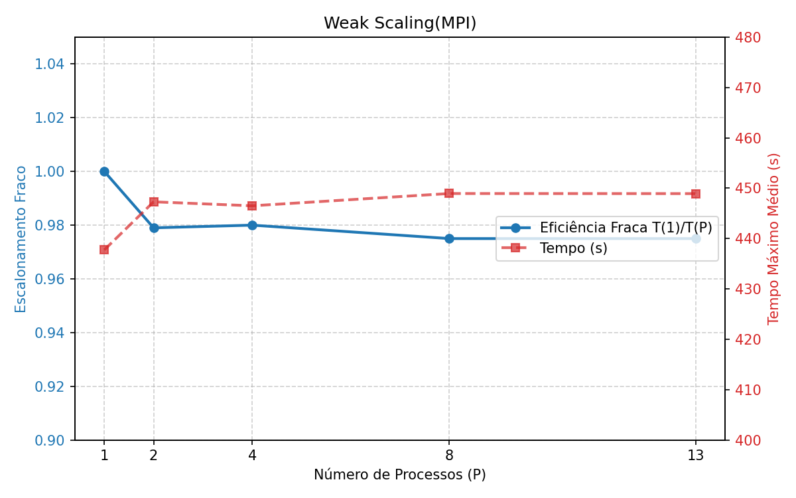
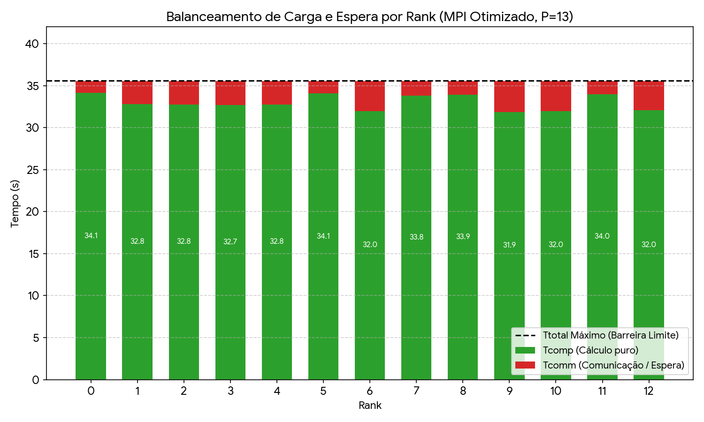
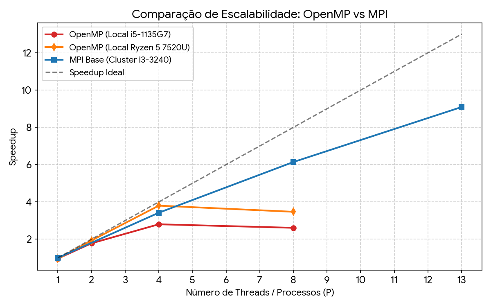
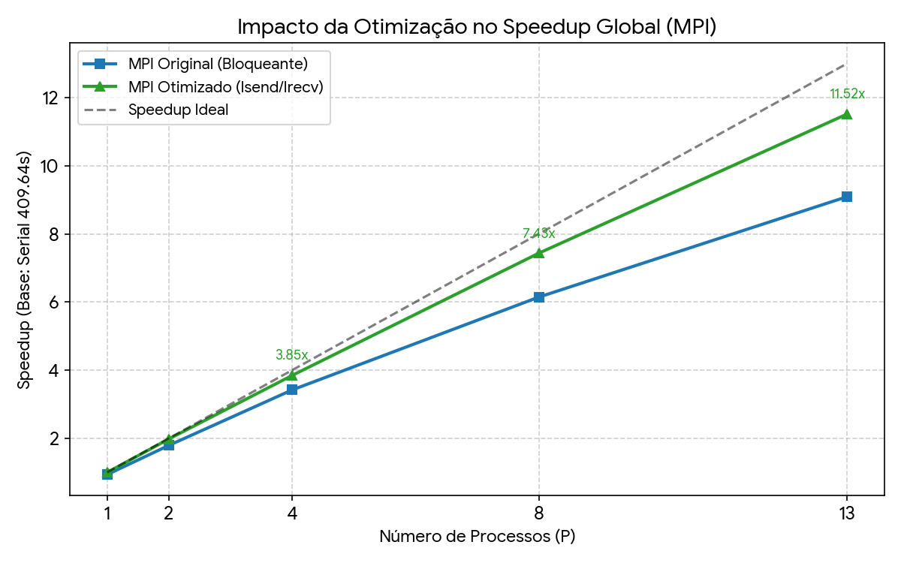

# Análise de Desempenho Paralelo com MPI

> **Objetivo:** documentar o algoritmo, a implementação serial e paralela, a metodologia experimental e a análise dos resultados, incluindo a comparação com OpenMP e a avaliação da otimização proposta.

## 1. Algoritmo, volume de dados e decomposição paralela

### 1.1 Descrição do algoritmo

O problema resolvido é a simulação do **Jogo da Vida (*Game of Life*) de Conway** em uma grade bidimensional $w \times h$ com **fronteiras toroidais**: a vizinhança "dá a volta" nas bordas, de modo que toda célula tem 8 vizinhos. Cada célula está viva (1) ou morta (0).

- **Entrada:** largura `w`, altura `h` e número de iterações `max_iter` (valores usados: 500, 500 e 50 000). O estado inicial é uma cruz: a coluna $w/2$ e a linha $h/2$ ficam vivas, e todas as demais células, mortas.
- **Etapas de cada geração:**
  1. para cada célula, contar os vizinhos vivos na janela $3 \times 3$ (descontando a própria célula), com índices circulares;
  2. aplicar a regra: a célula fica viva na próxima geração se tiver exatamente 3 vizinhos vivos, ou se estiver viva e tiver exatamente 2;
  3. a nova geração é calculada em um buffer auxiliar e copiada de volta à matriz principal.
- **Número de gerações:** o laço vai de `0` até `max_iter` inclusive, portanto são $N_{\text{iter}} + 1 = \mathbf{50\,001\text{ gerações}}$. Os dados confirmam: cada rank enviou $200\,004\,000\text{ B}$, que corresponde a $2\text{ colunas} \times 500\text{ células} \times 4\text{ B} \times 50\,001\text{ gerações}$.
- **Saída:** total de células vivas ao final da última geração, além dos tempos medidos.

### 1.2 Volume de dados

| Parâmetro | Valor |
|---|---|
| Tamanho da entrada ($N$) | Grade $500 \times 500 = 250\,000$ células; 50 000 iterações (50 001 gerações) |
| Tipo e tamanho dos elementos | `unsigned` (4 bytes) por célula |
| Volume total de dados | $250\,000 \times 4\text{ B} = 1\,000\,000\text{ B}$ ($\approx 1\text{ MB}$) por matriz; o programa mantém duas (estado atual e buffer auxiliar), $\approx 2\text{ MB}$ |
| Critério de validação do resultado | Total de células vivas ao final idêntico ao da versão serial (referência: **6952** células vivas para $500 \times 500$ e 50 000 iterações). No *strong scaling*, o total foi **idêntico ao do serial nas 15 execuções MPI** ($P \in \{1, 2, 4, 8, 13\}$; 3 repetições cada) |

**Validação por configuração** (total de células vivas impresso por cada execução):

| Experimento | Grade ($w \times h$) | P | Repetições | Total de células vivas | Resultado |
|---|---|---:|---:|---:|---|
| strong | $500 \times 500$ | 1 | 3 | 6952 | igual ao serial (6952) |
| strong | $500 \times 500$ | 2 | 3 | 6952 | igual ao serial (6952) |
| strong | $500 \times 500$ | 4 | 3 | 6952 | igual ao serial (6952) |
| strong | $500 \times 500$ | 8 | 3 | 6952 | igual ao serial (6952) |
| strong | $500 \times 500$ | 13 | 3 | 6952 | igual ao serial (6952) |
| weak | $1000 \times 500$ | 2 | 3 | 10 716 | idêntico nas 3 repetições; sem referência serial |
| weak | $2000 \times 500$ | 4 | 3 | 21 250 | idêntico nas 3 repetições; sem referência serial |
| weak | $4000 \times 500$ | 8 | 3 | 42 208 | idêntico nas 3 repetições; sem referência serial |
| weak | $6500 \times 500$ | 13 | 3 | 71 166 | idêntico nas 3 repetições; sem referência serial |

No *weak scaling* cada grade é diferente, e o serial só existe para $500 \times 500$; por isso nessas configurações só foi possível verificar que o total é **idêntico entre as 3 repetições**.

**Como o volume foi definido.** No *strong scaling* a grade foi mantida em $500 \times 500$ para todo $P$ (volume constante). No *weak scaling* a altura foi fixada em 500 e a largura foi $w = 500 \times P$, de modo que cada rank mantém **$500\text{ colunas} \times 500\text{ linhas} = 250\,000\text{ células}$ ($1\text{ MB}$ por matriz)** para todos os valores de $P$ testados (ver seção 5).

### 1.3 Decomposição paralela

O domínio é dividido **por colunas**. Cada rank recebe um bloco contíguo de colunas e *todas* as linhas, e guarda uma matriz local $h \times (lw + 2)$, em que $lw$ é o seu número de colunas e as duas colunas extras são **colunas-fantasma** (cópias das colunas de borda dos vizinhos). Os ranks formam um anel: o rank 0 é vizinho à esquerda do rank $P - 1$, o que reproduz a fronteira toroidal. A fronteira vertical é resolvida localmente com `% h`, porque cada rank tem todas as linhas.

- **Estratégia de decomposição:** por dados (decomposição de domínio por colunas), determinística, calculada por cada rank só a partir de `rank` e `size`.
- **Distribuição de dados:** cada rank calcula localmente suas colunas e inicializa a sua parte da cruz, sem comunicação. Apenas os parâmetros (`MPI_Bcast`) e os nomes dos nós (`MPI_Gather`) circulam no início.
- **Comunicação principal:** a cada geração, na versão base, cada rank faz **2 `MPI_Sendrecv` bloqueantes** com os vizinhos (esquerdo e direito), trocando uma coluna de $h$ elementos `unsigned` ($2\,000\text{ B}$) em cada sentido. Como uma coluna não é contígua em memória, usa-se um tipo derivado (`MPI_Type_vector`). Com $P = 1$ não há mensagens: as fantasmas são copiadas localmente. Ao final, `MPI_Reduce` com `MPI_SUM` reúne o total de células vivas no rank 0, e `MPI_Barrier` inicial e final delimitam a seção medida.
- **Resultados parciais:** cada rank conta suas células vivas e o `MPI_Reduce` soma as contagens no rank 0. Os tempos são impressos por cada rank (linha `RANK ... TCOMP ... TCOMM ... TTOTAL ... BYTES ...`) e agregados na etapa de análise.
- **Tratamento de divisão desigual:** com $\text{base} = \lfloor w/P \rfloor$, os primeiros $w \bmod P$ ranks recebem uma coluna extra. Para $w = 500$ (as faixas de colunas impressas pelas execuções MPI coincidem com estes valores):

| P | Colunas por rank |
|---|---|
| 1 | 500 |
| 2 | 250 e 250 |
| 4 | 125 em cada rank |
| 8 | ranks 0–3: 63 colunas; ranks 4–7: 62 colunas |
| 13 | ranks 0–5: 39 colunas; ranks 6–12: 38 colunas |

No *weak scaling* ($w = 500 \times P$) a divisão é exata: 500 colunas por rank em todas as configurações. A faixa de colunas de cada rank, impressa no início de cada execução (`Rank r/P rodando em nodeX (colunas a a b)`), coincidiu com a fórmula de decomposição nas 27 execuções MPI.

---

## 2. Configuração, compilação e execução

Os comandos abaixo são os que o script `run_all.sh` executa nas etapas `compile`, `serial`, `strong` e `weak`. Fontes utilizadas: `gol.c` (serial), `golmpi.c` (MPI base) e a implementação com comunicação não-bloqueante para a versão MPI otimizada.

### 2.1 Compilação e execução

**Compilação** (etapa `compile`):

```bash
gcc   -O2 -g -o programa_serial gol.c
mpicc -O2 -g -o programa_mpi    golmpi.c
```

**Arquivo de nós** (`resultados/machinefile`, gerado a partir de `hosts_nodes`; **um processo MPI por nó**, portanto $P \le$ número de nós acessíveis):

```text
node1 slots=1
node2 slots=1
...
node13 slots=1
```

**Serial** (etapa `serial`): executa no primeiro nó (`node1`) por `ssh`, sem argumentos. A grade e as iterações são fixas no código (500, 500 e 50 000) e devem coincidir com `W`, `H` e `ITER` do script.

```bash
ssh -n node1 "cd <diretório> && /usr/bin/time -v -o resultados/raw/serial_r1.time \
    ./programa_serial > resultados/raw/serial_r1.out 2> resultados/raw/serial_r1.err"
```

**MPI** (etapas `strong` e `weak`; cada configuração é repetida 3 vezes):

```bash
/usr/bin/time -v -o resultados/raw/mpi_P<P>_W<W>_H<H>_r<rep>.time \
  timeout 7200 \
  nohup mpirun -np <P> -machinefile resultados/machinefile \
        --map-by ppr:1:node --bind-to core --mca routed direct \
        ./programa_mpi <W> <H> <ITER> \
  < /dev/null > resultados/raw/mpi_P<P>_W<W>_H<H>_r<rep>.out \
              2> resultados/raw/mpi_P<P>_W<W>_H<H>_r<rep>.err
```

Parâmetros dos experimentos: *strong scaling* com $W = H = 500$, $\text{ITER} = 50000$ e $P \in \{1, 2, 4, 8, 13\}$; *weak scaling* com $H = 500$ e $W = 500 \times P$.

**Execução completa e geração das tabelas** (as tabelas são geradas no frontend a partir de `resultados/raw`):

```bash
nohup ./run_all.sh > run_all.out 2>&1 &         # todas as etapas, em segundo plano
./run_all.sh compile serial strong weak tables  # apenas etapas escolhidas
./run_all.sh tables                             # apenas regera as tabelas
```

### 2.2 Parâmetros do script e ambiente

Principais variáveis de configuração do script (valores usados):

| Variável | Valor | Função |
|---|---|---|
| `NODES_FILE` | `hosts_nodes` | arquivo com os nós (um por linha) |
| `W`, `H`, `ITER` | 500, 500, 50000 | grade e iterações do *strong scaling* |
| `WEAK_W1` | `W` (500) | largura base $W_{1}$ por processo no *weak scaling* ($w = W_{1} \times P$) |
| `P_LIST` | 1 2 4 8 13 | padrão do script: potências de 2 até o número de nós, mais o número de nós (13) |
| `REPS` | 3 | repetições no *strong* e no *weak* |
| `SERIAL_REPS` | 1 | repetições do serial |
| `RUN_TIMEOUT` | 7200 | tempo limite (s) por execução, para detectar *deadlock* |
| `MPI_EXTRA` | `--mca routed direct` | opções adicionais do `mpirun` (Open MPI) |

**Ambiente e hardware do cluster:**

- **Cluster:** UMBU; frontend `umbu`, composto por **13 nós de cômputo** (`node1` a `node13`), executando com 1 processo MPI por nó.
- **Hardware dos nós:** Processador Intel Core i3-3240, 2 GiB de memória RAM e 80 GiB de disco rígido por nó.
- **Implementação MPI:** Open MPI.
- **Compilador e opções:** `gcc`/`mpicc` com flags `-O2 -g`.

---

## 3. Tabelas de medição: `MPI_Wtime` e `/usr/bin/time -v`

### 3.1 Metodologia

**O que é medido.** Cada rank mede com `MPI_Wtime` a *seção paralela*: do fim de uma `MPI_Barrier` inicial ao fim de uma `MPI_Barrier` final (`TTOTAL`). A seção inclui a alocação e a inicialização da matriz local, as 50 001 gerações (troca de colunas e cálculo), a contagem local de células vivas e o `MPI_Reduce` do total. Ficam de fora a leitura dos parâmetros (`MPI_Bcast`), a identificação dos nós (`MPI_Gather`), a impressão e o início e o fim do runtime. Portanto, os tempos correspondem à **região paralela, e não ao tempo total da aplicação** (este aparece na seção 3.3). O tempo serial de referência é o tempo interno do `gol.c`, medido com `clock_gettime` (`CLOCK_MONOTONIC`) em torno da simulação.

**Repetições e aquecimento.** *Strong* e *weak scaling*: 3 repetições por $P$. Serial: 1 execução. **Não há execução de aquecimento** e nenhuma repetição foi descartada: todas entram nas médias.

Para cada execução, registra-se o tempo por rank e calculam-se, **por repetição**:

- **$T_{\text{max}}$:** maior `TTOTAL` entre os ranks. É o tempo de conclusão da execução paralela e a base do *speedup* e da escalabilidade.
- **$T_{\text{min}}$:** menor `TTOTAL` entre os ranks.
- **$T_{\text{média}}$:** média aritmética dos `TTOTAL` dos ranks.
- **Desvio padrão entre ranks:** *populacional* (divisor $P$) dos `TTOTAL` dos ranks.

Os valores das 3 repetições são então **promediados** ($T_{\text{max}}$ médio, $T_{\text{min}}$ médio etc.). O **desvio entre repetições** é *amostral* (divisor $n - 1$, com $n = 3$), aplicado ao $T_{\text{max}}$ das 3 repetições, e é o usado nas seções 4 e 5.

> **Atenção ao interpretar $T_{\text{max}}$ e $T_{\text{min}}$.** Como a seção termina em uma barreira, todos os ranks medem `TTOTAL` praticamente iguais ($T_{\text{max}} - T_{\text{min}} \le 0,0033\text{ s}$ em todas as configurações), mesmo quando a carga é desigual: quem termina antes espera na barreira, e essa espera é contada em `Tcomm`. Logo, a diferença entre $T_{\text{max}}$ e $T_{\text{min}}$ de `TTOTAL` **não** mede desequilíbrio de carga; ele é avaliado com `Tcomp` na seção 7.

### 3.2 `MPI_Wtime` por rank

`TTOTAL` por rank nas **3 repetições** do *strong scaling* (em todas as execuções, o rank $k$ rodou em `node`$k+1$, conforme o campo `HOST` das saídas):

| P | Repetição | Rank | Tempo (s) |
|---:|---:|---:|---:|
| 1 | 1 | 0 | 437,5185 |
| 1 | 2 | 0 | 438,0792 |
| 1 | 3 | 0 | 437,6849 |
| 2 | 1 | 0 | 228,6368 |
| 2 | 1 | 1 | 228,6336 |
| 2 | 2 | 0 | 228,8170 |
| 2 | 2 | 1 | 228,8137 |
| 2 | 3 | 0 | 228,5960 |
| 2 | 3 | 1 | 228,5927 |
| 4 | 1 | 0 | 119,8232 |
| 4 | 1 | 1 | 119,8218 |
| 4 | 1 | 2 | 119,8211 |
| 4 | 1 | 3 | 119,8208 |
| 4 | 2 | 0 | 119,7925 |
| 4 | 2 | 1 | 119,7911 |
| 4 | 2 | 2 | 119,7904 |
| 4 | 2 | 3 | 119,7901 |
| 4 | 3 | 0 | 119,7977 |
| 4 | 3 | 1 | 119,7964 |
| 4 | 3 | 2 | 119,7956 |
| 4 | 3 | 3 | 119,7953 |
| 8 | 1 | 0 | 66,6544 |
| 8 | 1 | 1 | 66,6530 |
| 8 | 1 | 2 | 66,6527 |
| 8 | 1 | 3 | 66,6526 |
| 8 | 1 | 4 | 66,6540 |
| 8 | 1 | 5 | 66,6530 |
| 8 | 1 | 6 | 66,6532 |
| 8 | 1 | 7 | 66,6540 |
| 8 | 2 | 0 | 66,6824 |
| 8 | 2 | 1 | 66,6810 |
| 8 | 2 | 2 | 66,6807 |
| 8 | 2 | 3 | 66,6807 |
| 8 | 2 | 4 | 66,6820 |
| 8 | 2 | 5 | 66,6810 |
| 8 | 2 | 6 | 66,6812 |
| 8 | 2 | 7 | 66,6821 |
| 8 | 3 | 0 | 66,6873 |
| 8 | 3 | 1 | 66,6859 |
| 8 | 3 | 2 | 66,6857 |
| 8 | 3 | 3 | 66,6856 |
| 8 | 3 | 4 | 66,6870 |
| 8 | 3 | 5 | 66,6860 |
| 8 | 3 | 6 | 66,6862 |
| 8 | 3 | 7 | 66,6870 |
| 13 | 1 | 0 | 45,0393 |
| 13 | 1 | 1 | 45,0389 |
| 13 | 1 | 2 | 45,0388 |
| 13 | 1 | 3 | 45,0393 |
| 13 | 1 | 4 | 45,0396 |
| 13 | 1 | 5 | 45,0402 |
| 13 | 1 | 6 | 45,0403 |
| 13 | 1 | 7 | 45,0408 |
| 13 | 1 | 8 | 45,0391 |
| 13 | 1 | 9 | 45,0387 |
| 13 | 1 | 10 | 45,0389 |
| 13 | 1 | 11 | 45,0397 |
| 13 | 1 | 12 | 45,0393 |
| 13 | 2 | 0 | 45,0796 |
| 13 | 2 | 1 | 45,0792 |
| 13 | 2 | 2 | 45,0791 |
| 13 | 2 | 3 | 45,0796 |
| 13 | 2 | 4 | 45,0798 |
| 13 | 2 | 5 | 45,0805 |
| 13 | 2 | 6 | 45,0805 |
| 13 | 2 | 7 | 45,0811 |
| 13 | 2 | 8 | 45,0793 |
| 13 | 2 | 9 | 45,0790 |
| 13 | 2 | 10 | 45,0792 |
| 13 | 2 | 11 | 45,0800 |
| 13 | 2 | 12 | 45,0796 |
| 13 | 3 | 0 | 45,0440 |
| 13 | 3 | 1 | 45,0436 |
| 13 | 3 | 2 | 45,0435 |
| 13 | 3 | 3 | 45,0440 |
| 13 | 3 | 4 | 45,0443 |
| 13 | 3 | 5 | 45,0449 |
| 13 | 3 | 6 | 45,0450 |
| 13 | 3 | 7 | 45,0456 |
| 13 | 3 | 8 | 45,0438 |
| 13 | 3 | 9 | 45,0434 |
| 13 | 3 | 10 | 45,0436 |
| 13 | 3 | 11 | 45,0445 |
| 13 | 3 | 12 | 45,0441 |

#### Resumo por configuração

Estatísticas de `TTOTAL` entre os ranks, médias das 3 repetições:

| P | Repetições | $T_{\text{max}}$ médio (s) | $T_{\text{min}}$ médio (s) | $T_{\text{média}}$ dos ranks (s) | Desvio padrão (s) |
|---:|---:|---:|---:|---:|---:|
| 1 | 3 | 437,7608 | 437,7608 | 437,7608 | 0,0000 |
| 2 | 3 | 228,6833 | 228,6800 | 228,6816 | 0,0016 |
| 4 | 3 | 119,8044 | 119,8021 | 119,8030 | 0,0009 |
| 8 | 3 | 66,6747 | 66,6729 | 66,6737 | 0,0006 |
| 13 | 3 | 45,0558 | 45,0537 | 45,0545 | 0,0006 |

O desvio padrão desta tabela é o **populacional entre ranks**, calculado em cada repetição e depois promediado. O **desvio entre repetições** (amostral) é apresentado nas seções 4 e 5 como "Desvio de $T_{\text{max}}$". Os dois medem coisas diferentes: o primeiro, a dispersão dentro de uma execução (e é quase nulo por causa da barreira final); o segundo, a variação de uma execução para outra.

### 3.3 `/usr/bin/time -v`

Processo medido: `timeout`, que executa `nohup mpirun ...` **no frontend**, ou seja, o launcher (o serial foi medido diretamente, sem launcher). A tabela abaixo exibe os dados de tempo real (*wall-clock*) extraídos dos registros:

| P | Repetição | Tempo real (s) |
|---:|---:|---:|
| serial | 1 | 409,650 |
| 1 | 1 | 439,930 |
| 1 | 2 | 439,880 |
| 1 | 3 | 439,490 |
| 2 | 1 | 230,480 |
| 2 | 2 | 230,640 |
| 2 | 3 | 230,420 |
| 4 | 1 | 122,130 |
| 4 | 2 | 121,630 |
| 4 | 3 | 121,640 |
| 8 | 1 | 68,600 |
| 8 | 2 | 68,540 |
| 8 | 3 | 68,550 |
| 13 | 1 | 47,000 |
| 13 | 2 | 46,940 |
| 13 | 3 | 46,910 |

#### Resumo do tempo real por configuração

| P | Tempo real médio (s) | Desvio entre repetições (s) | $T_{\text{max}}$ médio, `MPI_Wtime` (s) | Tempo real $-$ $T_{\text{max}}$ (s) |
|---:|---:|---:|---:|---:|
| 1 | 439,767 | 0,241 | 437,761 | 2,006 |
| 2 | 230,513 | 0,114 | 228,683 | 1,830 |
| 4 | 121,800 | 0,286 | 119,804 | 1,996 |
| 8 | 68,563 | 0,032 | 66,675 | 1,889 |
| 13 | 46,950 | 0,046 | 45,056 | 1,894 |

Comando usado:

```bash
/usr/bin/time -v -o <base>.time timeout 7200 nohup mpirun -np <P> -machinefile resultados/machinefile \
    --map-by ppr:1:node --bind-to core --mca routed direct ./programa_mpi <W> <H> <ITER>
```

#### Limitações de `/usr/bin/time` com o launcher

Quando executado sobre `mpirun` ou outro launcher, `/usr/bin/time -v` mede o processo que foi iniciado diretamente — normalmente o launcher no nó frontend — e não cada processo MPI individual nos nós de cômputo. Assim, métricas locais como uso de CPU, memória residente e falhas de página do comando refletem apenas o processo `mpirun`/`timeout` e não representam o comportamento dos ranks.

**No experimento:** o tempo real excede o $T_{\text{max}}$ medido com `MPI_Wtime` em **$1,83\text{ a }2,01\text{ s}$**, praticamente constante para todo $P$, enquanto no serial (sem launcher) a diferença entre o tempo real e o tempo interno é de apenas $0,006\text{ s}$. Isso é consistente com um custo fixo de início e fim do runtime (lançamento por `ssh`/`orted`). Por isso o tempo real **não** foi usado para *speedup* e escalabilidade; utiliza-se o $T_{\text{max}}$ medido por `MPI_Wtime`.

---

## 4. *Strong scaling*: desempenho e Lei de Amdahl

No *strong scaling* (escalabilidade forte), o tamanho total do problema permanece constante (grade $500 \times 500$, 50 001 gerações) enquanto o número de processos $P$ aumenta.

### 4.1 Resultados

| P | $T_{\text{max}}$ médio (s) | Desvio de $T_{\text{max}}$ (s) | Speedup médio | Desvio do speedup | Eficiência média (%) | Desvio da eficiência (%) |
|---:|---:|---:|---:|---:|---:|---:|
| 1 | 437,761 | 0,288 | 0,936 | 0,0006 | 93,58 | 0,06 |
| 2 | 228,683 | 0,118 | 1,791 | 0,0009 | 89,57 | 0,05 |
| 4 | 119,804 | 0,016 | 3,419 | 0,0005 | 85,48 | 0,01 |
| 8 | 66,675 | 0,018 | 6,144 | 0,0016 | 76,80 | 0,02 |
| 13 | 45,056 | 0,022 | 9,092 | 0,0044 | 69,94 | 0,03 |

- **Referência $T_{1}$:** tempo da **versão serial** (`gol.c`): **$409,644\text{ s}$** (1 execução, portanto sem desvio). O mesmo $T_{1}$ é usado em toda a tabela.
- $S(P) = T_{1} / T_{\text{max}}(P)$ e $E(P) = (S(P) / P) \times 100\%$, calculados **para cada uma das 3 repetições**; a tabela mostra a média e o desvio amostral entre elas.
- O desvio de $T_{\text{max}}$ é o desvio amostral entre as 3 repetições.

**O MPI com $P = 1$ é $6,86\%$ mais lento que o serial** ($T_{\text{max}}$ médio de $437,761\text{ s}$ contra $409,644\text{ s}$; o `Tcomp` de $P = 1$ é $437,7549\text{ s}$ e o `Tcomm` é nulo, então a diferença está no cálculo). Isso reduz todos os *speedups* da tabela por um fator de $\approx 0,936$.

**Referência alternativa (MPI com $P = 1$).** Para separar o efeito desse custo do efeito do paralelismo, a tabela abaixo usa $T_{1}$ igual ao $T_{\text{max}}$ médio do próprio MPI com $P = 1$ ($437,761\text{ s}$):

| P | Speedup | Eficiência (%) | 
|---:|---:|---:|
| 2 | 1,914 | 95,7 |
| 4 | 3,654 | 91,3 |
| 8 | 6,566 | 82,1 |
| 13 | 9,716 | 74,7 |

### 4.2 Gráfico de *strong scaling*


*Speedup* medido (referência: serial), com barras de erro (desvio amostral entre as 3 repetições, $\le 0,005$ e quase invisível nesta escala), a curva ideal $S(P) = P$ e a curva de Amdahl com $s = 0,0123$. O gráfico foi gerado a partir da tabela 4.1.

### 4.3 Comparação com a Lei de Amdahl

A Lei de Amdahl estima o *speedup* máximo no *strong scaling* quando uma fração $s$ do trabalho é serial:

$$S(P) = \frac{1}{s + \frac{1-s}{P}}$$

**Fração serial utilizada: $s = 0,0123$** ($1,23\%$). É um valor fixo, configurado no `run_all.sh` (variável `F_SERIAL`).

| P | Speedup medido | Speedup de Amdahl ($s = 0,0123$) | Amdahl $-$ medido | 
|---:|---:|---:|---:|
| 1 | 0,936 | 1,000 | 0,064 |
| 2 | 1,791 | 1,976 | 0,184 |
| 4 | 3,419 | 3,858 | 0,438 |
| 8 | 6,144 | 7,366 | 1,222 |
| 13 | 9,092 | 11,328 | 2,236 |

**Comparação.**

- O *speedup* medido fica **abaixo da curva de Amdahl em todo $P > 1$**, e a diferença cresce com $P$: de $0,184$ em $P = 2$ para $2,236$ em $P = 13$.
- **O que limita o *speedup* nos dados é a parte que não é cálculo.** O tempo do rank mais lento que não é computação ($\text{TTOTAL} - \text{Tcomp}$ máximo) fica **aproximadamente constante**, entre $9,4\text{ e }10,9\text{ s}$ para $P \ge 2$, enquanto o `Tcomp` cai com $1/P$. Esse custo é de comunicação e sincronização (seção 6). Em termos de Amdahl, um custo aditivo constante $c$ equivale a uma fração não escalável $s_{\text{ef}} = c / T_{1}$: com $T_{1} = 409,644\text{ s}$, os valores acima correspondem a $s_{\text{ef}}$ entre $2,3\%$ e $2,7\%$, ou seja, de $1,9\text{ a }2,2$ vezes o $s = 0,0123$ adotado. É isso que afasta a curva medida da teórica: a curva de Amdahl com esse $s$ é otimista porque ele é menor que a fração não escalável observada na prática devido à rede.

---

## 5. *Weak scaling*

No *weak scaling* (escalabilidade fraca), o volume de trabalho por processo permanece constante, de modo que o tamanho total $N_{\text{total}}$ cresce proporcionalmente a $P$.

| P | Grade ($w \times h$) | $N_{\text{total}}$ (células) | Dados por processo | $T_{\text{max}}$ médio (s) | Desvio de $T_{\text{max}}$ (s) | Escalabilidade fraca (*Weak scaling*) $T(1)/T(P)$ |
|---:|---|---:|---|---:|---:|---:|
| 1 | $500 \times 500$ | 250 000 | 250 000 células ($1\,000\,000\text{ B}$) | 437,761 | 0,288 | 1,000 |
| 2 | $1000 \times 500$ | 500 000 | 250 000 células ($1\,000\,000\text{ B}$) | 447,302 | 0,435 | 0,979 |
| 4 | $2000 \times 500$ | 1 000 000 | 250 000 células ($1\,000\,000\text{ B}$) | 446,508 | 0,065 | 0,980 |
| 8 | $4000 \times 500$ | 2 000 000 | 250 000 células ($1\,000\,000\text{ B}$) | 448,948 | 0,051 | 0,975 |
| 13 | $6500 \times 500$ | 3 250 000 | 250 000 células ($1\,000\,000\text{ B}$) | 448,931 | 0,051 | 0,975 |

$N_{\text{total}} = w \times h$, com $h = 500$ fixo e $w = 500 \times P$. Cada rank recebe exatamente $500\text{ colunas} \times 500\text{ linhas}$ (divisão exata, ver seção 1.3), portanto $250\,000$ células ($1\text{ MB}$ por matriz) para todo $P$. O $T_{\text{max}}$ médio e o desvio (amostral, 3 repetições) seguem as definições da seção 3.1. A métrica de **weak scaling** (escalabilidade fraca) é calculada por $T(1)/T(P)$, com $T(1)$ igual ao $T_{\text{max}}$ médio do MPI com $P = 1$ ($437,761\text{ s}$), referência apropriada aqui porque o tamanho total do problema muda com $P$.

### 5.1 Gráfico de *weak scaling*



### 5.2 Discussão

- O tempo permanece **aproximadamente constante**: a métrica de *weak scaling* fica entre $0,975$ e $0,980$ para $P \ge 2$, ou seja, $T_{\text{max}}$ só é $2,0\%$ a $2,6\%$ maior que o de $P = 1$.
- A maior parte desse aumento aparece **na passagem de $P = 1$ para $P = 2$** ($+9,54\text{ s}$, de um aumento total de até $11,19\text{ s}$), que é justamente quando surge a primeira comunicação via rede: no *strong scaling* o `Tcomm` com $P = 2$ é de $9,49\text{ s}$. De $P = 2$ a $P = 13$, o $T_{\text{max}}$ varia muito pouco ($446,5\text{ a }448,9\text{ s}$).
- Isso é consistente com um custo de comunicação **por rank aproximadamente constante**: cada rank troca sempre 2 colunas de 500 células com 2 vizinhos imediatos no anel, em qualquer $P$. O volume enviado por rank é constante ($200\,004\,000\text{ B}$, mais $8\text{ B}$ nos ranks $\neq 0$ pelo `MPI_Reduce`), e o **total** enviado na rede cresce linearmente com $P$ (de $400\,008\,008\text{ B}$ com $P = 2$ a $2\,600\,052\,096\text{ B}$ com $P = 13$).
- A fração de comunicação sobe de forma lenta ($2,37\%$ com $P = 2$ e $2,98\%$ com $P = 13$). Entre $P = 2$ e $P = 13$, o $T_{\text{max}}$ varia $2,4\text{ s}$ ($\approx 0,5\%$), mais do que os desvios entre repetições ($\le 0,435\text{ s}$), indicando uma leve sobrecarga de sincronização global à medida que o anel cresce.

---

## 6. Comunicação versus computação

**Como foram medidos.** `Tcomp` e `Tcomm` são acumulados em cada rank com `MPI_Wtime`, em intervalos consecutivos e, por construção, **mutuamente exclusivos**:

- **`Tcomm`** = tempo dentro de chamadas MPI da seção paralela: `MPI_Sendrecv` (troca de colunas), `MPI_Reduce` (total de células vivas) e `MPI_Barrier` final. **Inclui sincronização e espera**: a espera pelo rank mais lento na barreira final e nos `Sendrecv` bloqueantes é contada aqui.
- **`Tcomp`** = tempo fora de chamadas MPI: inicialização, cálculo da evolução (`evolve`) e contagem local. Com $P = 1$, a cópia local das bordas (que não é chamada MPI) entra em `Tcomp`.

Conferência nos dados (execução 1, todos os ranks): $T_{\text{comp}} + T_{\text{comm}}$ difere de `TTOTAL` em no máximo $0,0055\text{ s}$ ($\le 0,011\%$), o que confirma que os dois intervalos cobrem a seção medida sem sobreposição.

Dois valores de $F_{\text{comm}}$ são apresentados. O da **fórmula sugerida** usa as médias dos ranks; o **adotado no script** usa $T_{\text{comm, max}} / T_{\text{total, max}}$ (o rank que mais gastou em comunicação sobre o tempo total).

| P | $T_{\text{comp}}$ médio (s) | $T_{\text{comm}}$ médio (s) | $F_{\text{comm}}$ (%) $= T_{\text{comm}} / (T_{\text{comp}} + T_{\text{comm}}) \times 100$ | $F_{\text{comm}}$ (%) $= T_{\text{comm, max}} / T_{\text{total, max}}$ |
|---:|---:|---:|---:|---:|
| 1 | 437,7549 | 0,0000 | 0,00 | 0,00 |
| 2 | 219,2243 | 9,4523 | 4,13 | 4,15 |
| 4 | 110,0821 | 9,7160 | 8,11 | 8,25 |
| 8 | 55,0735 | 11,5952 | 17,39 | 18,11 |
| 13 | 34,0073 | 11,0428 | 24,51 | 25,56 |

$T_{\text{comp}}$ e $T_{\text{comm}}$ médios são as médias entre os ranks e entre as 3 repetições.

**Tendência.** O `Tcomp` cai aproximadamente com $1/P$ ($437,75\text{ s} \to 34,01\text{ s}$), mas o `Tcomm` **quase não muda**: de $9,45\text{ s}$ ($P = 2$) a $11,04\text{ s}$ ($P = 13$), com máximo de $11,60\text{ s}$ em $P = 8$. Por isso $F_{\text{comm}}$ sobe de $4,1\%$ para $24,5\%$ (ou $25,56\%$ no pior rank) e o ganho no *strong scaling* perde eficiência de $89,6\%$ ($P = 2$) para $69,9\%$ ($P = 13$): a comunicação passa a limitar o desempenho à medida que o cálculo por rank diminui.

**O que o `Tcomm` representa.**

- O volume por mensagem é pequeno: cada rank envia **$200\,004\,000\text{ B}$** em $100\,002$ mensagens de $2\,000\text{ B}$ (2 por geração), constante com $P$ (mais $8\text{ B}$ nos ranks $\neq 0$, do `MPI_Reduce`). Dividindo o `Tcomm` médio por $2 \times 50\,001$ chamadas, obtém-se **$95\text{ a }116\,\mu\text{s}$ por `MPI_Sendrecv`**. É um valor derivado que **inclui espera e sincronização**, não só transferência. Para mensagens de $2\text{ KB}$, isso é compatível com um custo dominado por latência de rede e sincronização, e não por largura de banda.
- O `Tcomm` mistura transferência e espera. Em $P = 13$ (execução 1), os ranks 6–12 (38 colunas) têm `Tcomm` maior que os ranks 0–5 (39 colunas) em **$0,91\text{ s}$**, que é praticamente a diferença de `Tcomp` entre os dois grupos ($0,91\text{ s}$): quem tem menos trabalho termina antes e espera. O `Tcomm` não deve ser lido, portanto, como custo puro da rede.

---

## 7. Balanceamento de carga por rank

### 7.1 Valores por rank

Valores da **execução 1** (as médias de `Tcomp` por rank nas 3 repetições estão na seção 7.2). O "trabalho atribuído" é o número de colunas do rank (faixas confirmadas nas saídas, seção 1.3), com 500 linhas por coluna.

| P | Rank | Tempo de computação (s) | Tempo de comunicação (s) | Tempo total medido (s) | Trabalho atribuído |
|---:|---:|---:|---:|---:|---|
| 1 | 0 | 437,5136 | 0,0000 | 437,5185 | 500 colunas (250 000 células) |
| 2 | 0 | 219,1686 | 9,4631 | 228,6368 | 250 colunas (125 000 células) |
| 2 | 1 | 219,2119 | 9,4171 | 228,6336 | 250 colunas (125 000 células) |
| 4 | 0 | 110,0388 | 9,7795 | 119,8232 | 125 colunas (62 500 células) |
| 4 | 1 | 109,9038 | 9,9130 | 119,8218 | 125 colunas (62 500 células) |
| 4 | 2 | 110,3429 | 9,4730 | 119,8211 | 125 colunas (62 500 células) |
| 4 | 3 | 110,0537 | 9,7622 | 119,8208 | 125 colunas (62 500 células) |
| 8 | 0 | 55,4671 | 11,1823 | 66,6544 | 63 colunas (31 500 células) |
| 8 | 1 | 55,4415 | 11,2065 | 66,6530 | 63 colunas (31 500 células) |
| 8 | 2 | 55,7409 | 10,9063 | 66,6527 | 63 colunas (31 500 células) |
| 8 | 3 | 55,3993 | 11,2484 | 66,6526 | 63 colunas (31 500 células) |
| 8 | 4 | 54,6233 | 12,0259 | 66,6540 | 62 colunas (31 000 células) |
| 8 | 5 | 54,5891 | 12,0594 | 66,6530 | 62 colunas (31 000 células) |
| 8 | 6 | 54,6113 | 12,0374 | 66,6532 | 62 colunas (31 000 células) |
| 8 | 7 | 54,6866 | 11,9623 | 66,6540 | 62 colunas (31 000 células) |
| 13 | 0 | 34,4808 | 10,5540 | 45,0393 | 39 colunas (19 500 células) |
| 13 | 1 | 34,5049 | 10,5299 | 45,0389 | 39 colunas (19 500 células) |
| 13 | 2 | 34,6704 | 10,3636 | 45,0388 | 39 colunas (19 500 células) |
| 13 | 3 | 34,4114 | 10,6239 | 45,0393 | 39 colunas (19 500 células) |
| 13 | 4 | 34,4678 | 10,5673 | 45,0396 | 39 colunas (19 500 células) |
| 13 | 5 | 34,4365 | 10,5994 | 45,0402 | 39 colunas (19 500 células) |
| 13 | 6 | 33,5752 | 11,4609 | 45,0403 | 38 colunas (19 000 células) |
| 13 | 7 | 33,5682 | 11,4680 | 45,0408 | 38 colunas (19 000 células) |
| 13 | 8 | 33,5993 | 11,4357 | 45,0391 | 38 colunas (19 000 células) |
| 13 | 9 | 33,5553 | 11,4792 | 45,0387 | 38 colunas (19 000 células) |
| 13 | 10 | 33,5732 | 11,4614 | 45,0389 | 38 colunas (19 000 células) |
| 13 | 11 | 33,5997 | 11,4361 | 45,0397 | 38 colunas (19 000 células) |
| 13 | 12 | 33,6386 | 11,3959 | 45,0393 | 38 colunas (19 000 células) |

### 7.2 Gráfico e análise de balanceamento



**Métrica de desequilíbrio.** O tempo de execução paralelo efetivo é determinado pelo $T_{\text{max}}$ porque a aplicação possui sincronização global: nenhum processo conclui até que o rank mais lento alcance a barreira final. Já o $T_{\text{média}}$ de `Tcomp` reflete o esforço médio ideal; assim, compara-se o maior `Tcomp` com a média dos ranks através da razão $T_{\text{max}}/T_{\text{média}} = T_{\text{comp, max}} / T_{\text{comp, médio}}$ ($1,000 =$ perfeitamente balanceado) e da **eficiência de balanceamento** $= (T_{\text{comp, médio}} / T_{\text{comp, max}}) \times 100\%$. Adotou-se o critério "balanceado se $T_{\text{max}}/T_{\text{média}} \le 1,05$". O "*speedup* se balanceado" resulta de remover de $T_{\text{max}}$ o excesso $T_{\text{comp, max}} - T_{\text{comp, médio}}$. Os valores abaixo são médias das 3 repetições:

| P | $T_{\text{comp}}$ máx (s) | $T_{\text{comp}}$ mín (s) | $T_{\text{comp}}$ médio (s) | Desvio entre ranks (s) | $T_{\text{max}}/T_{\text{média}}$ | Efic. de balanceamento (%) | Speedup medido | Speedup se balanceado | Classificação |
|---:|---:|---:|---:|---:|---:|---:|---:|---:|---|
| 1 | 437,7549 | 437,7549 | 437,7549 | 0,0000 | 1,000 | 100,0 | 0,94 | 0,94 | balanceado |
| 2 | 219,2298 | 219,2188 | 219,2243 | 0,0055 | 1,000 | 100,0 | 1,79 | 1,79 | balanceado |
| 4 | 110,3375 | 109,9167 | 110,0821 | 0,1554 | 1,002 | 99,8 | 3,42 | 3,43 | balanceado |
| 8 | 55,7309 | 54,5964 | 55,0735 | 0,4533 | 1,012 | 98,8 | 6,14 | 6,21 | balanceado |
| 13 | 34,7077 | 33,5347 | 34,0073 | 0,4603 | 1,021 | 98,0 | 9,09 | 9,24 | balanceado |

**Quem é o rank mais lento e por quê.** Todos os casos ficam abaixo do limite de $1,05$ (pior caso: $P = 13$, $T_{\text{max}}/T_{\text{média}} = 1,021$, eficiência de balanceamento de $98,0\%$). O desequilíbrio observado vem da **decomposição**: os primeiros $w \bmod P$ ranks recebem uma coluna a mais. A razão entre o `Tcomp` médio dos dois grupos coincide com a razão entre os números de colunas:

| P | Grupo com mais colunas | Colunas | $T_{\text{comp}}$ médio do grupo (s) | Grupo com menos colunas | Colunas | $T_{\text{comp}}$ médio do grupo (s) | Razão dos $T_{\text{comp}}$ | Razão das colunas |
|---:|---|---:|---:|---|---:|---:|---:|---:|
| 8 | ranks 0–3 | 63 | 55,5166 | ranks 4–7 | 62 | 54,6305 | 1,0162 | 1,0161 |
| 13 | ranks 0–5 | 39 | 34,4986 | ranks 6–12 | 38 | 33,5862 | 1,0272 | 1,0263 |

Com $P = 1, 2\text{ e }4$ a divisão é exata (500, 250 e 125 colunas) e o $T_{\text{max}}/T_{\text{média}}$ é $\le 1,002$. O custo de cálculo por célula é uniforme neste algoritmo, de modo que o trabalho é diretamente proporcional ao número de colunas.

**Esperas.** Os `TTOTAL` dos ranks são praticamente iguais (seção 3.1) porque a barreira final os equaliza: o rank com menos trabalho termina mais cedo e espera. Em $P = 13$ isso aparece no `Tcomm`, $\approx 0,9\text{ s}$ maior nos ranks de 38 colunas do que nos de 39 (seção 6). O ganho que se obteria eliminando esse desequilíbrio é mínimo: o *speedup* iria de $9,09$ para $9,24$ em $P = 13$ e de $6,14$ para $6,21$ em $P = 8$. Como o desequilíbrio máximo é de **uma coluna**, ele não pode ser reduzido por outra divisão em blocos de colunas inteiras; o resto de $500 \bmod P$ colunas sempre existirá.

**Variação entre nós.** Dentro de cada grupo de ranks com a mesma carga, o **rank 2 (`node3`) é o mais lento** em $P = 4, 8\text{ e }13$: $+0,31\%$, $+0,52\%$ e $+0,73\%$ sobre os pares do mesmo grupo (médias de 3 repetições). Com $P = 4$, em que todos os ranks têm 125 colunas, é esse rank que define o $T_{\text{max}}$ de cálculo.

---

## 8. Comparação OpenMP versus MPI

Esta seção compara o desempenho da paralelização em memória compartilhada (OpenMP), obtido no trabalho anterior, com o modelo de memória distribuída (MPI), desenvolvido neste trabalho.

**Atenção às limitações experimentais:** os testes foram executados em ambientes de hardware e configurações de problema distintos:

- **Ambiente OpenMP:** 1 nó local com processador Intel® Core™ i5-1135G7 (4 núcleos físicos / 8 threads), $12\text{ GB}$ de RAM DDR4, caches (L1: $320\text{ KiB}$ / L2: $5\text{ MB}$ / L3: $8\text{ MB}$) e SO Ubuntu 26.04 (kernel 7.0.0-29-generic), além de testes comparativos adicionais em uma CPU AMD Ryzen 5 7520U (4 núcleos físicos / 8 threads).
- **Ambiente MPI (cluster):** 13 nós de cômputo no cluster UMBU, cada um equipado com processador Intel Core i3-3240, $2\text{ GiB}$ de RAM e $80\text{ GiB}$ de disco rígido.

O tempo serial de referência para o OpenMP (no i5-1135G7) foi de **$22,10\text{ s}$**, enquanto para o MPI foi de **$409,64\text{ s}$**. Essa diferença expressiva decorre da carga de trabalho avaliada e da diferença de capacidade computacional entre os processadores locais mais modernos utilizados no OpenMP e os nós i3-3240 do cluster utilizados no MPI. Portanto, a comparação abaixo foca exclusivamente no **comportamento da escalabilidade (*speedup* e eficiência)**, e não nos tempos absolutos.

### 8.1 Tabela e gráfico comparativo de desempenho

| Modelo | Configuração | Tempo médio (s) | Speedup vs. serial | Eficiência (%) | Observações / limitações |
|---|---|---:|---:|---:|---|
| **Serial OMP** | 1 thread | 22,10 | $1,00\times$ | 100,0% | Referência local (i5-1135G7) |
| **OpenMP** | 1 thread | 22,99 | $0,96\times$ | 96,0% | *Overhead* base do runtime OMP |
| **OpenMP** | 2 threads | 12,42 | $1,78\times$ | 89,0% | Boa escalabilidade inicial |
| **OpenMP** | 4 threads | 7,90 | $2,80\times$ | 70,0% | **Pico ótimo** para os 4 núcleos físicos |
| **OpenMP** | 8 threads | 8,46 | $2,61\times$ | 32,6% | **Degradação** (*oversubscription* no SMT) |
| **Serial MPI** | 1 processo | 409,64 | $1,00\times$ | 100,0% | Referência no cluster (i3-3240) |
| **MPI Base** | 4 ranks (4 nós) | 119,80 | $3,42\times$ | 85,5% | Comunicação via rede afeta a eficiência |
| **MPI Base** | 8 ranks (8 nós) | 66,67 | $6,14\times$ | 76,8% | Continua escalando, sem contenção de CPU |
| **MPI Base** | 13 ranks (13 nós) | 45,06 | $9,09\times$ | 69,9% | Limite de *strong scaling* avaliado |



### 8.2 Análise de escalabilidade e arquitetura

#### 1. Limite físico versus distribuição (*oversubscription*)

- **OpenMP:** o *speedup* atinge seu pico em 4 threads ($2,80\times$ no i5-1135G7 e $3,80\times$ no Ryzen 5 7520U) e sofre degradação ao utilizar 8 threads, caindo para $2,61\times$ e $3,47\times$, respectivamente. Esse comportamento corresponde exatamente ao limite físico do hardware utilizado: ambos os processadores possuem **4 núcleos físicos**. Ao instanciar 8 threads explorando o SMT/Hyper-Threading, o sistema sofre penalidades de trocas de contexto (*context switching*) e contenção na hierarquia de memória cache e barramentos locais.
- **MPI:** a execução utiliza 1 processo por nó físico, distribuído em até 13 nós distintos do cluster. Cada processo executa isoladamente no processador local (i3-3240) e dispõe exclusivamente de seus $2\text{ GiB}$ de RAM. Nesse cenário, adicionam-se núcleos e controladores de memória reais a cada passo, evitando superalocação. Dessa forma, o MPI continua reduzindo o tempo global de execução de forma consistente, de $66,67\text{ s}$ para $45,06\text{ s}$, ao passar de 8 para 13 processos.


#### 2. Natureza do *overhead* (custo de paralelização)

- **OpenMP:** a redução da eficiência para $70\%$ com 4 threads decorre do custo de gerenciamento e sincronização de barreiras de threads pelo sistema operacional e da contenção na largura de banda de memória compartilhada e protocolos de coerência de cache.
- **MPI:** no cluster distribuído, não há coerência de cache global baseada em hardware entre os nós. A comunicação ocorre explicitamente pela rede Ethernet, com custos de latência, empacotamento e sincronização. Embora a eficiência do MPI também diminua gradativamente (atingindo $69,9\%$ em 13 nós na versão base), o *speedup* continua crescendo de forma monotônica.

## 8.3 Comparação conceitual: OpenMP × MPI

| Aspecto | OpenMP (dentro do nó) | MPI (entre nós) |
|---|---|---|
| **Modelo de memória** | Compartilhada: todas as *threads* acessam a mesma matriz | Distribuída: cada *rank* tem seu espaço de endereçamento isolado |
| **Decomposição do Jogo da Vida** | As *threads* dividem as colunas do laço `evolve` sobre a mesma matriz | O domínio é dividido em fatias de colunas, uma por *rank* |
| **Colunas-fantasma** | Desnecessárias: a *thread* lê diretamente as colunas vizinhas, com índices circulares (`% w`) | Necessárias: cada fatia guarda cópias das colunas de borda dos vizinhos |
| **Comunicação** | Sem mensagens; os dados são lidos da memória compartilhada | Explícita: `MPI_Sendrecv` de 2 colunas por geração, pela rede |
| **Sincronização** | Barreira ao fim de cada laço paralelo, a cada geração, mais contenção de memória e cache; ocorre em memória local e é bem menor que o custo de uma troca de mensagens pela rede | Troca síncrona com os vizinhos, `MPI_Barrier` e `MPI_Reduce`, com latência de rede |
| **Garantia de correção** | Buffer auxiliar (leitura da geração atual, escrita da próxima) e barreira antes da cópia | Troca das colunas-fantasma antes do cálculo de cada geração |
| **Escalabilidade** | Limitada pelos núcleos e pela memória de um nó | Cresce com o número de nós, limitada pelo custo de comunicação |
| **Limite observado** | Pico com 4 *threads* (núcleos físicos); degradação com 8 por SMT (seção 8.1) | *Speedup* crescente até 13 nós, com eficiência decrescente (seção 4) |
| **Complexidade de programação** | Baixa: diretivas (`#pragma omp parallel for`) sobre o código serial | Maior: decomposição explícita, tipos derivados, tratamento do resto da divisão |
| **Melhor uso** | Problema que cabe em um nó | Problema que excede a memória ou o poder de um nó |

---

## 9. Otimização proposta e comparação original versus otimizado

### 9.1 Descrição da otimização

Na versão base (`programa_mpi`), a troca das colunas-fantasma utilizava `MPI_Sendrecv`, uma operação bloqueante. Isso fazia com que a CPU permanecesse ociosa aguardando a conclusão das transferências pela rede antes de iniciar o cálculo da geração seguinte.

A otimização proposta substitui esse mecanismo por **operações assíncronas (não-bloqueantes)**, utilizando `MPI_Irecv` e `MPI_Isend`. O cálculo de cada geração passa a ser dividido em duas etapas: após disparar as requisições de rede para as colunas de borda, a CPU computa imediatamente o "miolo" da matriz (colunas internas de $2$ até $lw - 1$), que não depende dos dados dos vizinhos externos. Ao finalizar o miolo, uma chamada a `MPI_Waitall` garante a conclusão das transferências pendentes antes de calcular as duas colunas de fronteira ($1$ e $lw$).

### 9.2 Justificativa baseada nos dados

A análise do *strong scaling* da versão base revelou que a fração de comunicação ($F_{\text{comm}}$) crescia de $4,15\%$ ($P = 2$) para **$25,56\%$ ($P = 13$)**, tornando-se o principal limitador do *speedup*. Com a sobreposição assíncrona (*overlap* de comunicação e computação), o objetivo é ocultar a latência da rede atrás do tempo de processamento útil do miolo da matriz, reduzindo o tempo de espera em `Tcomm` sem alterar o volume de bytes transferidos.

### 9.3 Comparação experimental: original versus otimizado

A tabela e o gráfico abaixo comparam o desempenho da versão original com o da versão otimizada no cluster UMBU:

| P | $T_{\text{max}}$ original | $F_{\text{comm}}$ original | $T_{\text{max}}$ otimizado | $F_{\text{comm}}$ otimizado | Speedup relativo ($T_{\text{orig}}/T_{\text{otim}}$) | Speedup global ($T_{\text{serial}}/T_{\text{otim}}$) | Validação numérica |
|---:|---:|---:|---:|---:|---:|---:|---|
| **1** | 437,76 s | 0,00% | **410,56 s** | **0,00%** | **$1,06\times$** | **$1,00\times$** | 6.952 células (OK) |
| **2** | 228,68 s | 4,15% | **206,98 s** | **0,62%** | **$1,10\times$** | **$1,98\times$** | 6.952 células (OK) |
| **4** | 119,80 s | 8,25% | **106,53 s** | **3,22%** | **$1,12\times$** | **$3,85\times$** | 6.952 células (OK) |
| **8** | 66,67 s | 18,11% | **55,11 s** | **6,24%** | **$1,21\times$** | **$7,43\times$** | 6.952 células (OK) |
| **13** | 45,06 s | 25,56% | **35,57 s** | **10,37%** | **$1,27\times$** | **$11,52\times$** | 6.952 células (OK) |

*O cálculo de Fcomm da versão otimizada corresponde ao tempo máximo de comunicação dividido pelo tempo total, com base no log consolidado `nohup_otimizado_.out`.*



### 9.4 Discussão

Os resultados comprovam a eficácia da otimização proposta:

1. **Redução drástica da fração de comunicação:** para $P = 13$, a fração de comunicação caiu de $25,56\%$ para **$10,37\%$** (tempo máximo de comunicação reduzido de $\approx 11,5\text{ s}$ para $3,69\text{ s}$). Isso demonstra que a maior parte da transferência das colunas-fantasma ocorreu em *background* enquanto a CPU processava o miolo da submatriz.
2. **Ganho de desempenho crescente com $P$:** o *speedup* relativo ($T_{\text{orig}}/T_{\text{otim}}$) cresce à medida que adicionamos nós, passando de $1,10\times$ ($P = 2$) para **$1,27\times$ ($P = 13$)**, elevando o *speedup* global (frente ao serial de $409,64\text{ s}$) de $9,09\times$ para **$11,52\times$**. A otimização atua exatamente sobre o gargalo que mais penalizava as configurações com maior número de processos.
3. **Corretude preservada:** o total de células vivas ao final da execução permaneceu exatamente em **6.952 células** em todas as configurações testadas, confirmando que a separação do cálculo entre miolo e bordas após o `MPI_Waitall` preservou a integridade dos dados sem *race conditions*.

### 10 Modelo híbrido MPI + OpenMP: por que e quando

> **Escopo:** a versão híbrida não foi implementada nem medida neste trabalho. A discussão é conceitual.

**Por que sistemas do TOP500 combinam os dois modelos.** Os nós atuais têm dezenas ou centenas de núcleos. Usar um processo MPI por núcleo multiplica o número de *ranks*, a memória replicada e o custo das mensagens e das operações coletivas. A combinação usa cada modelo onde o hardware o favorece:

- **MPI entre nós:** memória distribuída, comunicação explícita pela rede.
- **OpenMP dentro do nó:** memória compartilhada, sem mensagens e sem colunas-fantasma entre as *threads*, que acessam a mesma matriz. Ainda há custo de sincronização (a barreira ao fim de cada laço paralelo, a cada geração) e de contenção de memória e cache, mas ele ocorre em memória local e é bem menor que o de uma troca de mensagens pela rede.

Com isso, menos *ranks* significam menos mensagens, menos dados replicados e menos sincronização global pela rede.

**Aplicação ao Jogo da Vida.** Na decomposição por colunas, cada rank troca sempre duas colunas-fantasma por geração, independentemente de $P$. Para usar todos os núcleos de um nó com MPI puro, seria preciso um rank por núcleo: cada rank teria menos colunas, mas continuaria trocando duas, o que aumenta o número total de mensagens, de colunas-fantasma replicadas e de participantes nas sincronizações, além de ampliar o desequilíbrio causado pelo resto da divisão. No modelo híbrido, usa-se **um rank por nó** e várias *threads* dentro dele: o nó mantém uma única fatia de colunas, as *threads* dividem o laço de `evolve` em memória compartilhada, e só as duas colunas de borda do nó atravessam a rede. A comunicação por rank não diminui, mas **não cresce** ao se usar mais núcleos, e as fronteiras entre núcleos do mesmo nó deixam de ser mensagens. No cluster UMBU, que rodou um processo por nó, os demais núcleos ficaram sem uso, o que torna o híbrido uma extensão natural. Como o híbrido reduz o tempo de cálculo sem reduzir a comunicação, ele deve ser combinado com a sobreposição de comunicação e cálculo (seção 9).

**Quando usar apenas um dos modelos.**

| Situação | Escolha | Motivo |
|---|---|---|
| Problema cabe em um nó | **Só OpenMP** | Sem rede nem fantasmas, código mais simples |
| Problema excede a memória ou o poder de um nó | **MPI** | Só o MPI cruza nós |
| Poucos núcleos por nó e muito trabalho por rank | **Só MPI** | O ganho do OpenMP seria pequeno frente à complexidade extra (afinidade, *thread safety*) |
| Muitos núcleos por nó e comunicação já limitando o *strong scaling* | **Híbrido** | Evita *ranks* demais e comunicação dominante |

Em OpenMP, convém evitar mais *threads* que núcleos físicos: o uso de SMT tende a degradar o desempenho por contenção de memória e cache, como observado na seção 8.

---

## 11. Conclusões

Com base nos experimentos conduzidos no cluster UMBU e nas análises apresentadas ao longo deste relatório, sintetizam-se as respostas para as questões fundamentais do estudo:

1. **O que foi aprendido sobre a implementação em memória distribuída?**
   A transição para memória distribuída com MPI exige decomposição explícita do domínio de dados (neste caso, divisão 1D por colunas com criação de colunas-fantasma para representar a vizinhança em anel toroidal). Diferente da memória compartilhada, cada rank opera em seu espaço de endereçamento isolado nos nós i3-3240 ($2\text{ GiB}$ de RAM), o que elimina conflitos de cache, mas exige trocas explícitas de mensagens a cada geração e sincronização coletiva (`MPI_Reduce` e `MPI_Barrier`). Além disso, verificou-se a importância de medir o tempo internamente com `MPI_Wtime`, visto que medições externas no frontend (`/usr/bin/time -v`) embutem um custo fixo de inicialização do runtime ($\approx 1,9\text{ s}$).

2. **Como $P$ afetou o tempo, o *speedup* e a eficiência?**
   - No **strong scaling** (grade fixa $500 \times 500$), o aumento de $P$ reduziu consistentemente o tempo de execução paralelo ($T_{\text{max}}$), caindo de $437,76\text{ s}$ ($P=1$) para $45,06\text{ s}$ ($P=13$) na versão base, o que representa um *speedup* de $9,09\times$ sobre o tempo serial ($409,64\text{ s}$). Entretanto, a eficiência caiu gradativamente de $93,58\%$ ($P=1$) para $69,94\%$ ($P=13$).
   - No **weak scaling** (carga fixa de $500 \times 500$ células por processo e grade global $500P \times 500$), o tempo de execução manteve-se altamente estável entre $446,51\text{ s}$ e $448,93\text{ s}$ de $P=2$ até $P=13$, sustentando um índice de *weak scaling* entre $97,5\%$ e $98,0\%$, validando na prática a Lei de Gustafson.

3. **Em que condições o custo de comunicação passou a limitar o desempenho?**
   O custo de comunicação passou a limitar o desempenho nas configurações de *strong scaling* a partir de $P=4$ (onde a curva medida começa a se afastar visivelmente da curva ideal e da projeção de Amdahl) e tornou-se crítico em $P=8$ e $P=13$. Como cada rank troca sempre 2 colunas por geração ($200\,004\,000\text{ B}$ ao longo de 50 001 gerações), o tempo gasto em comunicação e espera (`Tcomm`) permaneceu quase fixo entre $9,45\text{ s}$ e $11,60\text{ s}$, enquanto o tempo de computação (`Tcomp`) caiu com $1/P$ (de $437,75\text{ s}$ para $34,01\text{ s}$). Em $P=13$, a fração de comunicação atingiu $25,56\%$ do tempo total, agindo como uma fração não escalável efetiva ($\approx 2,5\%$) superior à fração serial pura do código ($1,23\%$).

4. **O que as medições por rank revelaram sobre o balanceamento de carga?**
   Revelaram que o algoritmo do Jogo da Vida com decomposição por colunas possui carga uniforme por célula e é intrinsecamente balanceado. Em todas as configurações, a razão $T_{\text{max}}/T_{\text{média}}$ de computação ficou $\le 1,021$ (eficiência de balanceamento $\ge 98,0\%$). O leve desequilíbrio em $P=8$ e $P=13$ deve-se exclusivamente ao resto da divisão inteira ($500 \bmod P$): em $P=13$, os ranks 0 a 5 processam 39 colunas ($T_{\text{comp}} \approx 34,50\text{ s}$) e os ranks 6 a 12 processam 38 colunas ($T_{\text{comp}} \approx 33,59\text{ s}$). Os ranks com uma coluna a menos terminam o cálculo $\approx 0,91\text{ s}$ antes e absorvem essa diferença aguardando na barreira e nas trocas síncronas, igualando o `TTOTAL` de todos os processos.

5. **Como os resultados de MPI se comparam aos de OpenMP, considerando as limitações experimentais?**
   Considerando que os testes ocorreram em arquiteturas distintas (OpenMP em CPUs locais de 4 núcleos físicos — Intel Core i5-1135G7 e AMD Ryzen 5 7520U — e MPI em até 13 nós Intel Core i3-3240), a comparação das curvas de escalabilidade mostra o impacto da arquitetura de memória e CPU. O OpenMP atingiu seu pico exatamente em 4 threads ($2,80\times$ no i5 e $3,80\times$ no Ryzen) e sofreu degradação em 8 threads ($2,61\times$ e $3,47\times$) devido a *oversubscription* (disputa por unidades de execução e cache via SMT). Em contrapartida, o MPI distribuiu 1 processo por nó físico isolado, adicionando CPU e memória reais sem contenção local, o que permitiu escalar continuamente até 13 processos ($9,09\times$ no MPI base e $11,52\times$ no MPI otimizado).

6. **A otimização proposta trouxe benefício mensurável e manteve a correção?**
   Sim. A substituição de `MPI_Sendrecv` por chamadas não-bloqueantes (`MPI_Isend`/`MPI_Irecv` e `MPI_Waitall`), sobrepondo o cálculo do miolo da matriz à transferência de rede das colunas de borda, reduziu a fração de comunicação em $P=13$ de $25,56\%$ para $10,37\%$ e diminuiu o $T_{\text{max}}$ de $45,06\text{ s}$ para $35,57\text{ s}$. Isso resultou em um *speedup* relativo de $1,27\times$ sobre a versão MPI original e elevou o *speedup* global para $11,52\times$, mantendo o resultado exato de **6.952 células vivas** em todas as execuções.

---

## Reprodutibilidade

Registro consolidado das informações do ambiente e execução para reprodução dos experimentos:

- **Nós e hardware do cluster:** cluster UMBU; frontend `umbu`; **13 nós de cômputo** (`node1` a `node13`), cada um equipado com processador **Intel Core i3-3240**, **$2\text{ GiB}$ de memória RAM** e **$80\text{ GiB}$ de disco rígido**, operando com 1 processo MPI por nó.
- **Ambientes de referência OpenMP:** processador Intel® Core™ i5-1135G7 (4 núcleos / 8 threads, $12\text{ GB}$ RAM DDR4, cache L3 de $8\text{ MB}$, Ubuntu 26.04 / kernel Linux 7.0.0-29-generic) e processador AMD Ryzen 5 7520U (4 núcleos / 8 threads).
- **Implementação MPI e compilação:** Open MPI; compilação com `gcc -O2 -g` (serial) e `mpicc -O2 -g` (MPI), conforme a etapa `compile` do script `run_all.sh`.
- **Comandos completos:** documentados na seção 2 (`run_all.sh` e os comandos `mpirun`, `ssh` e `/usr/bin/time -v`).
- **Tamanho da entrada e parâmetros:** *strong scaling*: grade $500 \times 500$, 50 000 iterações (50 001 gerações), $P \in \{1, 2, 4, 8, 13\}$. *Weak scaling*: $h = 500$, $w = 500 \times P$. Opções do `mpirun`: `--map-by ppr:1:node --bind-to core --mca routed direct`.
- **Número de repetições e critério de agregação:** 3 repetições no *strong* e no *weak scaling*; 1 execução do serial. $T_{\text{max}}$ por repetição (maior `TTOTAL` entre os ranks); médias e desvio amostral entre repetições (seção 3.1).
- **Localização dos códigos, logs e gráficos:** diretório `resultados/` (`raw/` com `.out`, `.time` e `.err` de cada execução, `tabelas/`, `RELATORIO_TABELAS.md`, `dados_strong_scaling.csv`, `machinefile`, `parametros.txt`, `comandos_executados.log`, `interferencia.log`), log `nohup_otimizado_.out` e gráficos `grafico_strong_scaling.png`, `1_comparacao_openmp_mpi.png`, `2_mpi_original_vs_otimizado.png`, `3_balanceamento_p13.png` e `4_weak_scaling.png`.
