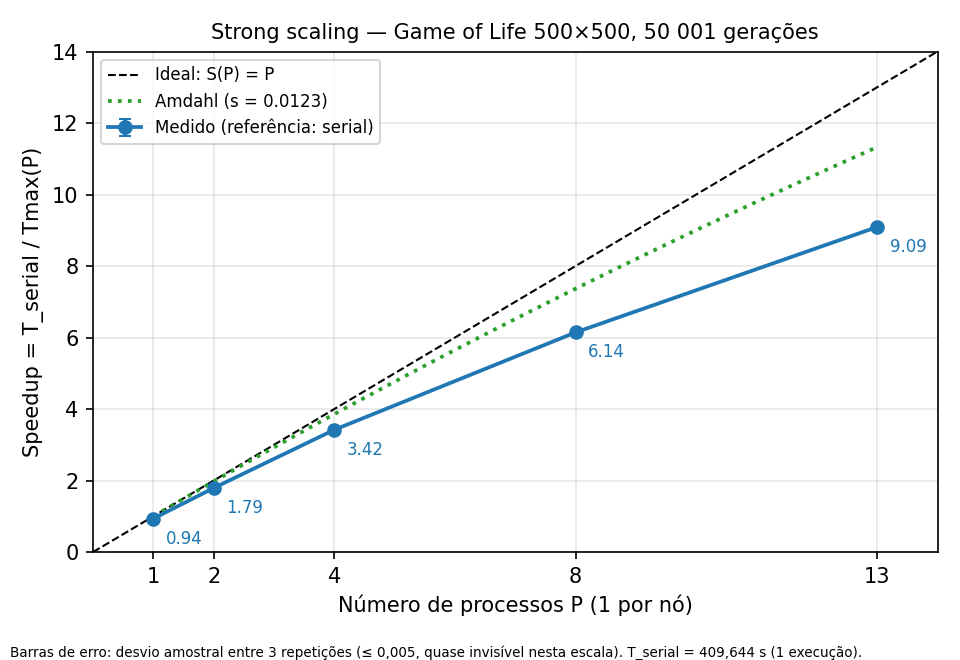

# Análise de Desempenho Paralelo com MPI

> **Objetivo:** documentar o algoritmo, a implementação serial e paralela, a metodologia experimental e a análise dos resultados, incluindo a comparação com OpenMP e a avaliação da otimização proposta.
>
> **Orientação:** substitua os campos entre colchetes pelos dados medidos e inclua as saídas reais das ferramentas. Não preencha lacunas com valores estimados.

## 1. Algoritmo, volume de dados e decomposição paralela

### 1.1 Descrição do algoritmo

O problema resolvido é a simulação do **Jogo da Vida (*Game of Life*) de Conway** em uma grade bidimensional `w × h` com **fronteiras toroidais**: a vizinhança "dá a volta" nas bordas, de modo que toda célula tem 8 vizinhos. Cada célula está viva (1) ou morta (0).

- **Entrada:** largura `w`, altura `h` e número de iterações `max_iter` (valores usados: 500, 500 e 50 000). O estado inicial é uma cruz: a coluna `w/2` e a linha `h/2` ficam vivas, e todas as demais células, mortas.
- **Etapas de cada geração:**
  1. para cada célula, contar os vizinhos vivos na janela 3×3 (descontando a própria célula), com índices circulares;
  2. aplicar a regra: a célula fica viva na próxima geração se tiver exatamente 3 vizinhos vivos, ou se estiver viva e tiver exatamente 2;
  3. a nova geração é calculada em um buffer auxiliar e copiada de volta à matriz principal.
- **Número de gerações:** o laço vai de `0` até `max_iter` inclusive, portanto são `max_iter + 1` = **50 001 gerações**. Os dados confirmam: cada rank enviou 200 004 000 B, que é 2 colunas × 500 células × 4 B × 50 001 gerações.
- **Saída:** total de células vivas ao final da última geração, além dos tempos medidos.

### 1.2 Volume de dados

| Parâmetro | Valor |
|---|---|
| Tamanho da entrada (`N`) | Grade 500 × 500 = 250 000 células; 50 000 iterações (50 001 gerações) |
| Tipo e tamanho dos elementos | `unsigned` (4 bytes) por célula |
| Volume total de dados | 250 000 × 4 B = 1 000 000 B (≈ 1 MB) por matriz; o programa mantém duas (estado atual e buffer auxiliar), ≈ 2 MB |
| Critério de validação do resultado | Total de células vivas ao final idêntico ao da versão serial (referência: **6952** células vivas para 500 × 500 e 50 000 iterações). No *strong scaling*, o total foi **idêntico ao do serial nas 15 execuções MPI** (P = 1, 2, 4, 8, 13; 3 repetições cada) |

**Validação por configuração** (total de células vivas impresso por cada execução; fonte: `resultados/raw/*.out`):

| Experimento | Grade (w × h) | P | Repetições | Total de células vivas | Resultado |
|---|---|---:|---:|---:|---|
| strong | 500 × 500 | 1 | 3 | 6952 | igual ao serial (6952) |
| strong | 500 × 500 | 2 | 3 | 6952 | igual ao serial (6952) |
| strong | 500 × 500 | 4 | 3 | 6952 | igual ao serial (6952) |
| strong | 500 × 500 | 8 | 3 | 6952 | igual ao serial (6952) |
| strong | 500 × 500 | 13 | 3 | 6952 | igual ao serial (6952) |
| weak | 1000 × 500 | 2 | 3 | 10 716 | idêntico nas 3 repetições; sem referência serial |
| weak | 2000 × 500 | 4 | 3 | 21 250 | idêntico nas 3 repetições; sem referência serial |
| weak | 4000 × 500 | 8 | 3 | 42 208 | idêntico nas 3 repetições; sem referência serial |
| weak | 6500 × 500 | 13 | 3 | 71 166 | idêntico nas 3 repetições; sem referência serial |

No *weak scaling* cada grade é diferente, e o serial só existe para 500 × 500; por isso nessas configurações só foi possível verificar que o total é **idêntico entre as 3 repetições**.

> **[PENDENTE]** Validar ao menos uma grade do *weak scaling* (por exemplo, 1000 × 500) contra uma execução serial ou MPI com P = 1 na mesma grade, já que não há referência serial para elas.

**Como o volume foi definido.** No *strong scaling* a grade foi mantida em 500 × 500 para todo `P` (volume constante). No *weak scaling* a altura foi fixada em 500 e a largura foi `w = 500 × P`, de modo que cada rank mantém **500 colunas × 500 linhas = 250 000 células (1 MB por matriz)** para todos os valores de `P` testados (ver seção 5).

### 1.3 Decomposição paralela

O domínio é dividido **por colunas**. Cada rank recebe um bloco contíguo de colunas e *todas* as linhas, e guarda uma matriz local `h × (lw + 2)`, em que `lw` é o seu número de colunas e as duas colunas extras são **colunas-fantasma** (cópias das colunas de borda dos vizinhos). Os ranks formam um anel: o rank 0 é vizinho à esquerda do rank `P − 1`, o que reproduz a fronteira toroidal. A fronteira vertical é resolvida localmente com `% h`, porque cada rank tem todas as linhas.

- **Estratégia de decomposição:** por dados (decomposição de domínio por colunas), determinística, calculada por cada rank só a partir de `rank` e `size`.
- **Distribuição de dados:** cada rank calcula localmente suas colunas e inicializa a sua parte da cruz, sem comunicação. Apenas os parâmetros (`MPI_Bcast`) e os nomes dos nós (`MPI_Gather`) circulam no início.
- **Comunicação principal:** a cada geração, cada rank faz **2 `MPI_Sendrecv` bloqueantes** com os vizinhos (esquerdo e direito), trocando uma coluna de `h` `unsigned` (2 000 B) em cada sentido. Como uma coluna não é contígua em memória, usa-se um tipo derivado (`MPI_Type_vector`). Com `P = 1` não há mensagens: as fantasmas são copiadas localmente. Ao final, `MPI_Reduce` com `MPI_SUM` reúne o total de células vivas no rank 0, e `MPI_Barrier` inicial e final delimitam a seção medida.
- **Resultados parciais:** cada rank conta suas células vivas e o `MPI_Reduce` soma as contagens no rank 0. Os tempos são impressos por cada rank (linha `RANK ... TCOMP ... TCOMM ... TTOTAL ... BYTES ...`) e agregados na etapa de análise.
- **Tratamento de divisão desigual:** com `base = ⌊w/P⌋`, os primeiros `w mod P` ranks recebem uma coluna extra. Para `w = 500` (as faixas de colunas impressas pelas execuções MPI coincidem com estes valores):

| P | Colunas por rank |
|---|---|
| 1 | 500 |
| 2 | 250 e 250 |
| 4 | 125 em cada rank |
| 8 | ranks 0–3: 63 colunas; ranks 4–7: 62 colunas |
| 13 | ranks 0–5: 39 colunas; ranks 6–12: 38 colunas |

No *weak scaling* (`w = 500 × P`) a divisão é exata: 500 colunas por rank em todas as configurações. A faixa de colunas de cada rank, impressa no início de cada execução (`Rank r/P rodando em nodeX (colunas a a b)`), coincidiu com a fórmula de decomposição nas 27 execuções MPI.

## 2. Código-fonte: versões serial, MPI e MPI otimizada

### 2.1 Versão serial

Arquivo: [`[caminho-do-arquivo-serial]`]( [caminho-do-arquivo-serial] )

```c
/* Inclua aqui o código serial ou forneça o caminho para o arquivo. */
```

### 2.2 Versão MPI original

Arquivo: [`[caminho-do-arquivo-mpi]`]( [caminho-do-arquivo-mpi] )

```c
/* Inclua aqui o código MPI original ou forneça o caminho para o arquivo. */
```

### 2.3 Versão MPI otimizada

Arquivo: [`[caminho-do-arquivo-mpi-otimizado]`]( [caminho-do-arquivo-mpi-otimizado] )

```c
/* Inclua aqui o código MPI otimizado ou forneça o caminho para o arquivo. */
```

### 2.4 Compilação e execução

Os comandos abaixo são os que o script `run_all.sh` executa nas etapas `compile`, `serial`, `strong` e `weak`. Fontes: `gol.c` (serial) e `golmpi.c` (MPI).

**Compilação** (etapa `compile`):

```bash
gcc   -O2 -g -o programa_serial gol.c
mpicc -O2 -g -o programa_mpi    golmpi.c
```

**Arquivo de nós** (`resultados/machinefile`, gerado a partir de `hosts_nodes`; **um processo MPI por nó**, portanto `P` ≤ número de nós acessíveis):

```text
node1 slots=1
node2 slots=1
...
node13 slots=1
```

**Serial** (etapa `serial`): executa no primeiro nó (`node1`) por `ssh`, sem argumentos. A grade e as iterações são fixas no código (500, 500 e 50 000) e devem coincidir com `W`, `H` e `ITER` do script.

```bash
ssh -n node1 "cd <diretório> && /usr/bin/time -v -o resultados/raw/serial_r1.time \
    ./programa_serial > resultados/raw/serial_r1.out 2> resultados/raw/serial_r1.err"
```

**MPI** (etapas `strong` e `weak`; cada configuração é repetida 3 vezes):

```bash
/usr/bin/time -v -o resultados/raw/mpi_P<P>_W<W>_H<H>_r<rep>.time \
  timeout 7200 \
  nohup mpirun -np <P> -machinefile resultados/machinefile \
        --map-by ppr:1:node --bind-to core --mca routed direct \
        ./programa_mpi <W> <H> <ITER> \
  < /dev/null > resultados/raw/mpi_P<P>_W<W>_H<H>_r<rep>.out \
              2> resultados/raw/mpi_P<P>_W<W>_H<H>_r<rep>.err
```

Parâmetros dos experimentos: *strong* com `W = H = 500`, `ITER = 50000` e `P` ∈ {1, 2, 4, 8, 13}; *weak* com `H = 500` e `W = 500 × P`.

**Execução completa e geração das tabelas** (as tabelas são geradas no frontend a partir de `resultados/raw`):

```bash
nohup ./run_all.sh > run_all.out 2>&1 &         # todas as etapas, em segundo plano
./run_all.sh compile serial strong weak tables  # apenas etapas escolhidas
./run_all.sh tables                             # apenas regera as tabelas
```

Principais variáveis de configuração do script (valores usados):

| Variável | Valor | Função |
|---|---|---|
| `NODES_FILE` | `hosts_nodes` | arquivo com os nós (um por linha) |
| `W`, `H`, `ITER` | 500, 500, 50000 | grade e iterações do *strong scaling* |
| `WEAK_W1` | `W` (500) | largura por processo no *weak scaling* (`w = WEAK_W1 × P`) |
| `P_LIST` | 1 2 4 8 13 | padrão do script: potências de 2 até o número de nós, mais o número de nós (13) |
| `REPS` | 3 | repetições no *strong* e no *weak* |
| `SERIAL_REPS` | 1 | repetições do serial |
| `RUN_TIMEOUT` | 7200 | tempo limite (s) por execução, para detectar *deadlock* |
| `MPI_EXTRA` | `--mca routed direct` | opções adicionais do `mpirun` (Open MPI) |

**Ambiente e versões:**

- **Cluster:** UMBU; frontend `umbu`, nós `node1` a `node13` (um processo MPI por nó).
- **Implementação MPI:** Open MPI (conforme as mensagens do runtime nos logs); versão **[PENDENTE: `mpirun --version`]**.
- **Compilador e opções:** `gcc`/`mpicc` com `-O2 -g` (comandos da etapa `compile`); versão **[PENDENTE: `gcc --version`]**.
- **Sistema operacional, kernel, CPU, memória e rede dos nós:** **[PENDENTE: gerados pela etapa `env` em `resultados/ambiente.txt`]**.

## 3. Tabelas de medição: `MPI_Wtime` e `/usr/bin/time -v`

### 3.1 Metodologia

**O que é medido.** Cada rank mede com `MPI_Wtime` a *seção paralela*: do fim de uma `MPI_Barrier` inicial ao fim de uma `MPI_Barrier` final (`TTOTAL`). A seção inclui a alocação e a inicialização da matriz local, as 50 001 gerações (troca de colunas e cálculo), a contagem local de células vivas e o `MPI_Reduce` do total. Ficam de fora a leitura dos parâmetros (`MPI_Bcast`), a identificação dos nós (`MPI_Gather`), a impressão e o início e o fim do runtime. Portanto, os tempos correspondem à **região paralela, e não ao tempo total da aplicação** (este aparece na seção 3.3). O tempo serial de referência é o tempo interno do `gol.c`, medido com `clock_gettime` (`CLOCK_MONOTONIC`) em torno da simulação.

**Repetições e aquecimento.** *Strong* e *weak scaling*: 3 repetições por `P`. Serial: 1 execução. **Não há execução de aquecimento** e nenhuma repetição foi descartada: todas entram nas médias.

Para cada execução, registra-se o tempo por rank e calculam-se, **por repetição**:

- **Tmax:** maior `TTOTAL` entre os ranks. É o tempo de conclusão da execução paralela e a base do speedup e da eficiência.
- **Tmin:** menor `TTOTAL` entre os ranks.
- **Tmédia:** média aritmética dos `TTOTAL` dos ranks.
- **Desvio padrão entre ranks:** *populacional* (divisor `P`) dos `TTOTAL` dos ranks.

Os valores das 3 repetições são então **promediados** (Tmax médio, Tmin médio etc.). O **desvio entre repetições** é *amostral* (divisor `n − 1`, com `n = 3`), aplicado ao Tmax das 3 repetições, e é o usado nas seções 4 e 5.

> **Atenção ao interpretar Tmax e Tmin.** Como a seção termina em uma barreira, todos os ranks medem `TTOTAL` praticamente iguais (Tmax − Tmin ≤ 0,0033 s em todas as configurações), mesmo quando a carga é desigual: quem termina antes espera na barreira, e essa espera é contada em `Tcomm`. Logo, a diferença entre Tmax e Tmin de `TTOTAL` **não** mede desequilíbrio de carga; ele é avaliado com `Tcomp` na seção 9.

### 3.2 `MPI_Wtime` por rank

`TTOTAL` por rank nas **3 repetições** do *strong scaling* (em todas as execuções, o rank *k* rodou em `node`*k+1*, conforme o campo `HOST` das saídas):

| P | Repetição | Rank | Tempo (s) |
|---:|---:|---:|---:|
| 1 | 1 | 0 | 437,5185 |
| 1 | 2 | 0 | 438,0792 |
| 1 | 3 | 0 | 437,6849 |
| 2 | 1 | 0 | 228,6368 |
| 2 | 1 | 1 | 228,6336 |
| 2 | 2 | 0 | 228,8170 |
| 2 | 2 | 1 | 228,8137 |
| 2 | 3 | 0 | 228,5960 |
| 2 | 3 | 1 | 228,5927 |
| 4 | 1 | 0 | 119,8232 |
| 4 | 1 | 1 | 119,8218 |
| 4 | 1 | 2 | 119,8211 |
| 4 | 1 | 3 | 119,8208 |
| 4 | 2 | 0 | 119,7925 |
| 4 | 2 | 1 | 119,7911 |
| 4 | 2 | 2 | 119,7904 |
| 4 | 2 | 3 | 119,7901 |
| 4 | 3 | 0 | 119,7977 |
| 4 | 3 | 1 | 119,7964 |
| 4 | 3 | 2 | 119,7956 |
| 4 | 3 | 3 | 119,7953 |
| 8 | 1 | 0 | 66,6544 |
| 8 | 1 | 1 | 66,6530 |
| 8 | 1 | 2 | 66,6527 |
| 8 | 1 | 3 | 66,6526 |
| 8 | 1 | 4 | 66,6540 |
| 8 | 1 | 5 | 66,6530 |
| 8 | 1 | 6 | 66,6532 |
| 8 | 1 | 7 | 66,6540 |
| 8 | 2 | 0 | 66,6824 |
| 8 | 2 | 1 | 66,6810 |
| 8 | 2 | 2 | 66,6807 |
| 8 | 2 | 3 | 66,6807 |
| 8 | 2 | 4 | 66,6820 |
| 8 | 2 | 5 | 66,6810 |
| 8 | 2 | 6 | 66,6812 |
| 8 | 2 | 7 | 66,6821 |
| 8 | 3 | 0 | 66,6873 |
| 8 | 3 | 1 | 66,6859 |
| 8 | 3 | 2 | 66,6857 |
| 8 | 3 | 3 | 66,6856 |
| 8 | 3 | 4 | 66,6870 |
| 8 | 3 | 5 | 66,6860 |
| 8 | 3 | 6 | 66,6862 |
| 8 | 3 | 7 | 66,6870 |
| 13 | 1 | 0 | 45,0393 |
| 13 | 1 | 1 | 45,0389 |
| 13 | 1 | 2 | 45,0388 |
| 13 | 1 | 3 | 45,0393 |
| 13 | 1 | 4 | 45,0396 |
| 13 | 1 | 5 | 45,0402 |
| 13 | 1 | 6 | 45,0403 |
| 13 | 1 | 7 | 45,0408 |
| 13 | 1 | 8 | 45,0391 |
| 13 | 1 | 9 | 45,0387 |
| 13 | 1 | 10 | 45,0389 |
| 13 | 1 | 11 | 45,0397 |
| 13 | 1 | 12 | 45,0393 |
| 13 | 2 | 0 | 45,0796 |
| 13 | 2 | 1 | 45,0792 |
| 13 | 2 | 2 | 45,0791 |
| 13 | 2 | 3 | 45,0796 |
| 13 | 2 | 4 | 45,0798 |
| 13 | 2 | 5 | 45,0805 |
| 13 | 2 | 6 | 45,0805 |
| 13 | 2 | 7 | 45,0811 |
| 13 | 2 | 8 | 45,0793 |
| 13 | 2 | 9 | 45,0790 |
| 13 | 2 | 10 | 45,0792 |
| 13 | 2 | 11 | 45,0800 |
| 13 | 2 | 12 | 45,0796 |
| 13 | 3 | 0 | 45,0440 |
| 13 | 3 | 1 | 45,0436 |
| 13 | 3 | 2 | 45,0435 |
| 13 | 3 | 3 | 45,0440 |
| 13 | 3 | 4 | 45,0443 |
| 13 | 3 | 5 | 45,0449 |
| 13 | 3 | 6 | 45,0450 |
| 13 | 3 | 7 | 45,0456 |
| 13 | 3 | 8 | 45,0438 |
| 13 | 3 | 9 | 45,0434 |
| 13 | 3 | 10 | 45,0436 |
| 13 | 3 | 11 | 45,0445 |
| 13 | 3 | 12 | 45,0441 |

Fonte: linhas `RANK ... TTOTAL ...` de `resultados/raw/mpi_P<P>_W500_H500_r<rep>.out`. Os valores por rank das execuções do *weak scaling* estão nos arquivos `resultados/raw/mpi_P<P>_W<500·P>_H500_r<rep>.out`.

#### Resumo por configuração

Estatísticas de `TTOTAL` entre os ranks, médias das 3 repetições:

| P | Repetições | Tmax médio (s) | Tmin médio (s) | Tmédia dos ranks (s) | Desvio padrão (s) |
|---:|---:|---:|---:|---:|---:|
| 1 | 3 | 437,7608 | 437,7608 | 437,7608 | 0,0000 |
| 2 | 3 | 228,6833 | 228,6800 | 228,6816 | 0,0016 |
| 4 | 3 | 119,8044 | 119,8021 | 119,8030 | 0,0009 |
| 8 | 3 | 66,6747 | 66,6729 | 66,6737 | 0,0006 |
| 13 | 3 | 45,0558 | 45,0537 | 45,0545 | 0,0006 |

O desvio padrão desta tabela é o **populacional entre ranks**, calculado em cada repetição e depois promediado. O **desvio entre repetições** (amostral) é apresentado nas seções 4 e 5 como "Desvio de Tmax". Os dois medem coisas diferentes: o primeiro, a dispersão dentro de uma execução (e é quase nulo por causa da barreira final); o segundo, a variação de uma execução para outra.

### 3.3 `/usr/bin/time -v`

Processo medido: `timeout`, que executa `nohup mpirun ...` **no frontend**, ou seja, o launcher (o serial foi medido diretamente, sem launcher).

| P | Repetição | Tempo real (s) | Tempo de usuário (s) | Tempo de sistema (s) | CPU (%) | RSS máximo (unidade) | Falhas de página | Trocas de contexto |
|---:|---:|---:|---:|---:|---:|---:|---:|---:|
| serial | 1 | 409,650 | n/d | n/d | n/d | n/d | n/d | n/d |
| 1 | 1 | 439,930 | n/d | n/d | n/d | n/d | n/d | n/d |
| 1 | 2 | 439,880 | n/d | n/d | n/d | n/d | n/d | n/d |
| 1 | 3 | 439,490 | n/d | n/d | n/d | n/d | n/d | n/d |
| 2 | 1 | 230,480 | n/d | n/d | n/d | n/d | n/d | n/d |
| 2 | 2 | 230,640 | n/d | n/d | n/d | n/d | n/d | n/d |
| 2 | 3 | 230,420 | n/d | n/d | n/d | n/d | n/d | n/d |
| 4 | 1 | 122,130 | n/d | n/d | n/d | n/d | n/d | n/d |
| 4 | 2 | 121,630 | n/d | n/d | n/d | n/d | n/d | n/d |
| 4 | 3 | 121,640 | n/d | n/d | n/d | n/d | n/d | n/d |
| 8 | 1 | 68,600 | n/d | n/d | n/d | n/d | n/d | n/d |
| 8 | 2 | 68,540 | n/d | n/d | n/d | n/d | n/d | n/d |
| 8 | 3 | 68,550 | n/d | n/d | n/d | n/d | n/d | n/d |
| 13 | 1 | 47,000 | n/d | n/d | n/d | n/d | n/d | n/d |
| 13 | 2 | 46,940 | n/d | n/d | n/d | n/d | n/d | n/d |
| 13 | 3 | 46,910 | n/d | n/d | n/d | n/d | n/d | n/d |

`n/d` = não disponível em `RELATORIO_TABELAS.md`.

> **[PENDENTE]** Os campos de usuário, sistema e RSS aparecem como `n/d` no relatório gerado, e CPU (%), falhas de página e trocas de contexto não são extraídos pela análise. É preciso conferir o conteúdo de `resultados/raw/*.time`.

#### Resumo do tempo real por configuração

| P | Tempo real médio (s) | Desvio entre repetições (s) | Tmax médio, `MPI_Wtime` (s) | Tempo real − Tmax (s) |
|---:|---:|---:|---:|---:|
| 1 | 439,767 | 0,241 | 437,761 | 2,006 |
| 2 | 230,513 | 0,114 | 228,683 | 1,830 |
| 4 | 121,800 | 0,286 | 119,804 | 1,996 |
| 8 | 68,563 | 0,032 | 66,675 | 1,889 |
| 13 | 46,950 | 0,046 | 45,056 | 1,894 |

Comando usado:

```bash
/usr/bin/time -v -o <base>.time timeout 7200 nohup mpirun -np <P> -machinefile resultados/machinefile \
    --map-by ppr:1:node --bind-to core --mca routed direct ./programa_mpi <W> <H> <ITER>
```

#### Limitações de `/usr/bin/time` com o launcher

Quando executado sobre `mpirun` ou outro launcher, `/usr/bin/time -v` mede o processo que foi iniciado diretamente — normalmente o launcher — e não necessariamente cada processo MPI individual. Assim, seus dados de CPU, memória residente e falhas de página podem não representar a soma nem o comportamento isolado dos ranks. A forma como os processos filhos são contabilizados depende da ferramenta, do launcher e do ambiente.

Para caracterizar cada rank, use medições dentro da aplicação ou execute a ferramenta de medição no processo MPI apropriado. Informe explicitamente qual processo foi medido e evite comparar métricas de escopos diferentes como se fossem equivalentes.

**No experimento:** o tempo real excede o Tmax medido com `MPI_Wtime` em **1,83 a 2,01 s**, praticamente constante para todo `P`, enquanto no serial (sem launcher) a diferença entre o tempo real e o tempo interno é de apenas 0,006 s. Isso é consistente com um custo fixo de início e fim do runtime (lançamento por `ssh`/`orted`), mas esse custo não foi medido isoladamente. Por isso o tempo real **não** foi usado para speedup e eficiência; usa-se o Tmax por `MPI_Wtime`.

## 4. *Strong scaling*: desempenho e Lei de Amdahl

No *strong scaling*, o tamanho total do problema permanece constante (grade 500 × 500, 50 001 gerações) enquanto o número de processos `P` aumenta.

### 4.1 Resultados

| P | Tmax médio (s) | Desvio de Tmax (s) | Speedup médio | Desvio do speedup | Eficiência média (%) | Desvio da eficiência (%) |
|---:|---:|---:|---:|---:|---:|---:|
| 1 | 437,761 | 0,288 | 0,936 | 0,0006 | 93,58 | 0,06 |
| 2 | 228,683 | 0,118 | 1,791 | 0,0009 | 89,57 | 0,05 |
| 4 | 119,804 | 0,016 | 3,419 | 0,0005 | 85,48 | 0,01 |
| 8 | 66,675 | 0,018 | 6,144 | 0,0016 | 76,80 | 0,02 |
| 13 | 45,056 | 0,022 | 9,092 | 0,0044 | 69,94 | 0,03 |

- **Referência `T1`:** tempo da **versão serial** (`gol.c`): **409,644 s** (1 execução, portanto sem desvio). O mesmo `T1` é usado em toda a tabela.
- `Speedup(P) = T1 / Tmax(P)` e `Eficiência(P) = Speedup(P) / P × 100%`, calculados **para cada uma das 3 repetições**; a tabela mostra a média e o desvio amostral entre elas. (Os valores coincidem, nas casas exibidas, com os de `RELATORIO_TABELAS.md`, que usa `T1 / Tmax médio`.)
- O desvio de Tmax é o desvio amostral entre as 3 repetições.

**O MPI com `P = 1` é 6,86% mais lento que o serial** (Tmax médio de 437,761 s contra 409,644 s; o `Tcomp` de P = 1 é 437,7549 s e o `Tcomm` é nulo, então a diferença está no cálculo). Isso reduz todos os speedups da tabela por um fator de ≈ 0,936.

**Referência alternativa (MPI com `P = 1`).** Para separar o efeito desse custo do efeito do paralelismo, a tabela abaixo usa `T1 =` Tmax médio do próprio MPI com `P = 1` (437,761 s). É uma tabela separada, para não misturar referências:

| P | Speedup | Eficiência (%) | Karp-Flatt *e* |
|---:|---:|---:|---:|
| 2 | 1,914 | 95,7 | 0,0448 |
| 4 | 3,654 | 91,3 | 0,0316 |
| 8 | 6,566 | 82,1 | 0,0312 |
| 13 | 9,716 | 74,7 | 0,0282 |

### 4.2 Gráfico de *strong scaling*



Speedup medido (referência: serial), com barras de erro (desvio amostral entre as 3 repetições, ≤ 0,005 e quase invisível nesta escala), a curva ideal `Speedup(P) = P` e a curva de Amdahl com `s = 0,0123`. O gráfico foi gerado a partir da tabela 4.1.

### 4.3 Comparação com a Lei de Amdahl

A Lei de Amdahl estima o speedup máximo quando uma fração `s` do trabalho é serial:

$$S(P) = \frac{1}{s + \frac{1-s}{P}}$$


**Fração serial utilizada: `s = 0,0123`** (1,23%). É um valor fixo, configurado no `run_all.sh` (variável `F_SERIAL`) e descrito no script como medido no serial; **não foi ajustado aos resultados deste relatório**.

> **[PENDENTE]** O procedimento da medição de `s` não está registrado nos dados. Antes da entrega, documentar como foi obtido (ou refazer a medição).

| P | Speedup medido | Speedup de Amdahl (s = 0,0123) | Amdahl − medido | Karp-Flatt *e* (ref. serial) | Karp-Flatt *e* (ref. MPI P = 1) |
|---:|---:|---:|---:|---:|---:|
| 1 | 0,936 | 1,000 | 0,064 | n/d | n/d |
| 2 | 1,791 | 1,976 | 0,184 | 0,1165 | 0,0448 |
| 4 | 3,419 | 3,858 | 0,438 | 0,0566 | 0,0316 |
| 8 | 6,144 | 7,366 | 1,222 | 0,0432 | 0,0312 |
| 13 | 9,092 | 11,328 | 2,236 | 0,0358 | 0,0282 |

**Comparação.**

- O speedup medido fica **abaixo da curva de Amdahl em todo P > 1**, e a diferença cresce com `P`: de 0,184 em P = 2 para 2,236 em P = 13.
- **O que limita o speedup nos dados é a parte que não é cálculo.** O tempo do rank mais lento que não é computação (`TTOTAL − Tcomp` máximo) fica **aproximadamente constante**, entre 9,4 e 10,9 s para P ≥ 2, enquanto o `Tcomp` cai com 1/P. Esse custo é de comunicação e sincronização (seção 6) e **não é uma fração serial no sentido de Amdahl**; uma fração `s` fixa não o captura, e é isso que afasta a curva medida da teórica.
- O Karp-Flatt com referência no serial **diminui** com `P` (0,1165 → 0,0358). Isso é compatível com o excesso de 6,9% do MPI com `P = 1`, que entra no *e* e se dilui à medida que `P` cresce. Com a referência no próprio MPI com `P = 1`, o *e* fica entre 0,028 e 0,032 a partir de `P = 4`, o que é compatível com um custo aditivo aproximadamente fixo, e não com uma fração serial crescente. Trata-se de uma interpretação dos dados, não de uma causa verificada.
- A interpretação acima combina os dados desta seção com os da seção 6; a hipótese de que o custo é dominado pela latência das mensagens pequenas deve ser confirmada com o `mpiP` (seção 7, pendente).

## 5. *Weak scaling*

No *weak scaling*, o volume de trabalho por processo permanece constante, de modo que o tamanho total `Ntotal` cresce com `P`.

| P | Grade (w × h) | Ntotal (células) | Dados por processo | Tmax médio (s) | Desvio de Tmax (s) | Eficiência fraca T(1)/T(P) |
|---:|---|---:|---|---:|---:|---:|
| 1 | 500 × 500 | 250 000 | 250 000 células (1 000 000 B) | 437,761 | 0,288 | 1,000 |
| 2 | 1000 × 500 | 500 000 | 250 000 células (1 000 000 B) | 447,302 | 0,435 | 0,979 |
| 4 | 2000 × 500 | 1 000 000 | 250 000 células (1 000 000 B) | 446,508 | 0,065 | 0,980 |
| 8 | 4000 × 500 | 2 000 000 | 250 000 células (1 000 000 B) | 448,948 | 0,051 | 0,975 |
| 13 | 6500 × 500 | 3 250 000 | 250 000 células (1 000 000 B) | 448,931 | 0,051 | 0,975 |

`Ntotal = w × h`, com `h = 500` fixo e `w = 500 × P`. Cada rank recebe exatamente 500 colunas × 500 linhas (divisão exata, ver seção 1.3), portanto 250 000 células (1 MB por matriz) para todo `P`. O Tmax médio e o desvio (amostral, 3 repetições) seguem as definições da seção 3.1. A **eficiência fraca** é `T(1)/T(P)`, com `T(1)` = Tmax médio do MPI com `P = 1` (437,761 s), referência apropriada aqui porque o tamanho do problema muda com `P`.

**Discussão.**

- O tempo permanece **aproximadamente constante**: a eficiência fraca fica entre 0,975 e 0,980 para P ≥ 2, ou seja, Tmax só é 2,0% a 2,6% maior que o de P = 1.
- A maior parte desse aumento aparece **na passagem de P = 1 para P = 2** (+9,54 s, de um aumento total de até 11,19 s), que é justamente quando surge a primeira comunicação: no *strong scaling* o `Tcomm` com P = 2 é de 9,49 s. De P = 2 a P = 13, o Tmax varia pouco (446,5 a 448,9 s).
- Isso é consistente com um custo de comunicação **por rank aproximadamente constante**: cada rank troca sempre 2 colunas de 500 células com 2 vizinhos, em qualquer `P`. O volume enviado por rank é constante (200 004 000 B, mais 8 B nos ranks ≠ 0 pelo `MPI_Reduce`), e o **total** enviado cresce linearmente com `P` (de 400 008 008 B com P = 2 a 2 600 052 096 B com P = 13).
- A fração de comunicação sobe de forma lenta (2,37% com P = 2 e 2,98% com P = 13). Entre P = 2 e P = 13, o Tmax varia 2,4 s (≈ 0,5%), mais do que os desvios entre repetições (≤ 0,435 s), então essa variação não é apenas ruído entre repetições. Os dados não permitem atribuí-la a uma causa específica; possíveis fatores (latência e sincronização do anel, rede, variação entre nós) não foram isolados.

## 6. Comunicação versus computação

**Como foram medidos.** `Tcomp` e `Tcomm` são acumulados em cada rank com `MPI_Wtime`, em intervalos consecutivos e, por construção, **mutuamente exclusivos**:

- **`Tcomm`** = tempo dentro de chamadas MPI da seção paralela: `MPI_Sendrecv` (troca de colunas), `MPI_Reduce` (total de células vivas) e `MPI_Barrier` final. **Inclui sincronização e espera**: a espera pelo rank mais lento na barreira final e nos `Sendrecv` bloqueantes é contada aqui.
- **`Tcomp`** = tempo fora de chamadas MPI: inicialização, cálculo da evolução (`evolve`) e contagem local. Com `P = 1`, a cópia local das bordas (que não é chamada MPI) entra em `Tcomp`.

Conferência nos dados (execução 1, todos os ranks): `Tcomp + Tcomm` difere de `TTOTAL` em no máximo 0,0055 s (≤ 0,011%), o que confirma que os dois intervalos cobrem a seção medida sem sobreposição.

Dois valores de `Fcomm` são apresentados. O da **fórmula sugerida** usa as médias dos ranks; o **adotado no script** usa `Tcomm_max / Ttotal_max` (o rank que mais gastou em comunicação sobre o tempo total).

| P | Tcomp médio (s) | Tcomm médio (s) | Fcomm (%) = Tcomm / (Tcomp + Tcomm) × 100 | Fcomm (%) = Tcomm_max / Ttotal_max |
|---:|---:|---:|---:|---:|
| 1 | 437,7549 | 0,0000 | 0,00 | 0,00 |
| 2 | 219,2243 | 9,4523 | 4,13 | 4,15 |
| 4 | 110,0821 | 9,7160 | 8,11 | 8,25 |
| 8 | 55,0735 | 11,5952 | 17,39 | 18,11 |
| 13 | 34,0073 | 11,0428 | 24,51 | 25,56 |

`Tcomp` e `Tcomm` médios são as médias entre os ranks e entre as 3 repetições.

**Tendência.** O `Tcomp` cai aproximadamente com 1/P (437,75 s → 34,01 s), mas o `Tcomm` **quase não muda**: de 9,45 s (P = 2) a 11,04 s (P = 13), com máximo de 11,60 s em P = 8. Por isso `Fcomm` sobe de 4,1% para 24,5% (fórmula sugerida) e a eficiência do *strong scaling* cai de 89,6% (P = 2) para 69,9% (P = 13): a comunicação passa a limitar o desempenho à medida que o cálculo por rank diminui.

**O que o `Tcomm` representa.**

- O volume é pequeno: cada rank envia **200 004 000 B** em 100 002 mensagens de 2 000 B (2 por geração), constante com `P` (mais 8 B nos ranks ≠ 0, do `MPI_Reduce`). Dividindo o `Tcomm` médio por `2 × 50 001` chamadas, obtém-se **95 a 116 µs por `MPI_Sendrecv`**. É um valor derivado que **inclui espera e sincronização**, não só transferência. Para mensagens de 2 KB, isso é compatível com um custo dominado por latência e sincronização, e não por largura de banda; **essa hipótese ainda precisa ser confirmada** (por exemplo, com o `mpiP`, seção 7, pendente).
- O `Tcomm` mistura transferência e espera. Em P = 13 (execução 1), os ranks 6–12 (38 colunas) têm `Tcomm` maior que os ranks 0–5 (39 colunas) em **0,91 s**, que é praticamente a diferença de `Tcomp` entre os dois grupos (0,91 s): quem tem menos trabalho termina antes e espera. O `Tcomm` não deve ser lido, portanto, como custo puro da rede.

## 7. Relatório do mpiP

### 7.1 Saída real

Inclua a saída original do mpiP, preservando os cabeçalhos, as unidades e as estatísticas relevantes. Remova apenas informações sensíveis ou irrelevantes, se necessário.

```text
[COLE AQUI A SAÍDA REAL DO mpiP]
```

Registre a versão do mpiP, o comando de execução, o número de ranks e as condições do experimento.

### 7.2 Análise das três chamadas MPI mais caras

| Posição | Chamada MPI | Tempo acumulado (s) | % do tempo MPI | Número de chamadas | Interpretação |
|---:|---|---:|---:|---:|---|
| 1 | [chamada] | [valor] | [valor] | [valor] | [análise] |
| 2 | [chamada] | [valor] | [valor] | [valor] | [análise] |
| 3 | [chamada] | [valor] | [valor] | [valor] | [análise] |

Identifique as três chamadas de maior custo conforme uma métrica claramente indicada (por exemplo, tempo acumulado). Explique o papel de cada chamada, se o custo é esperado e quais alterações poderiam reduzi-lo. Não confunda tempo acumulado com tempo médio por chamada.

## 8. `perf stat` por nó: IPC e cache misses

### 8.1 Metodologia e saída real

Informe o comando utilizado, a versão do `perf`, o nó ou máquina avaliada, o processo monitorado e os eventos habilitados. Inclua a saída real de cada nó.

**Nó [identificação]:**

```text
[COLE AQUI A SAÍDA REAL DO perf stat]
```

Repita o bloco para cada nó ou ambiente avaliado.

### 8.2 Tabela comparativa

| Nó | P | Ciclos | Instruções | IPC | Cache references | Cache misses | Taxa de cache misses (%) |
|---|---:|---:|---:|---:|---:|---:|---:|
| [nó] | [P] | [valor] | [valor] | [valor] | [valor] | [valor] | [valor] |

Definições, quando os eventos estiverem disponíveis e forem comparáveis:

- `IPC = instruções / ciclos`
- `Taxa de cache misses = cache misses / cache references × 100%`

Verifique os nomes e a disponibilidade dos eventos na plataforma. Se a contagem for multiplexada, escalada ou indisponível, registre isso. Não compare diretamente eventos diferentes entre nós sem explicar as diferenças de hardware e configuração.

### 8.3 Análise

Discuta o IPC como indicador agregado de instruções concluídas por ciclo, sem tratá-lo isoladamente como medida absoluta de desempenho. Relacione cache misses, ciclos, instruções, tempo de execução e características do algoritmo. Diferencie métricas coletadas por nó de métricas coletadas por rank ou processo.

## 9. Balanceamento de carga por rank

### 9.1 Valores por rank

Valores da **execução 1** (as médias de `Tcomp` por rank nas 3 repetições estão na seção 9.2). O "trabalho atribuído" é o número de colunas do rank (faixas confirmadas nas saídas, seção 1.3), com 500 linhas por coluna.

| P | Rank | Tempo de computação (s) | Tempo de comunicação (s) | Tempo total medido (s) | Trabalho atribuído |
|---:|---:|---:|---:|---:|---|
| 1 | 0 | 437,5136 | 0,0000 | 437,5185 | 500 colunas (250 000 células) |
| 2 | 0 | 219,1686 | 9,4631 | 228,6368 | 250 colunas (125 000 células) |
| 2 | 1 | 219,2119 | 9,4171 | 228,6336 | 250 colunas (125 000 células) |
| 4 | 0 | 110,0388 | 9,7795 | 119,8232 | 125 colunas (62 500 células) |
| 4 | 1 | 109,9038 | 9,9130 | 119,8218 | 125 colunas (62 500 células) |
| 4 | 2 | 110,3429 | 9,4730 | 119,8211 | 125 colunas (62 500 células) |
| 4 | 3 | 110,0537 | 9,7622 | 119,8208 | 125 colunas (62 500 células) |
| 8 | 0 | 55,4671 | 11,1823 | 66,6544 | 63 colunas (31 500 células) |
| 8 | 1 | 55,4415 | 11,2065 | 66,6530 | 63 colunas (31 500 células) |
| 8 | 2 | 55,7409 | 10,9063 | 66,6527 | 63 colunas (31 500 células) |
| 8 | 3 | 55,3993 | 11,2484 | 66,6526 | 63 colunas (31 500 células) |
| 8 | 4 | 54,6233 | 12,0259 | 66,6540 | 62 colunas (31 000 células) |
| 8 | 5 | 54,5891 | 12,0594 | 66,6530 | 62 colunas (31 000 células) |
| 8 | 6 | 54,6113 | 12,0374 | 66,6532 | 62 colunas (31 000 células) |
| 8 | 7 | 54,6866 | 11,9623 | 66,6540 | 62 colunas (31 000 células) |
| 13 | 0 | 34,4808 | 10,5540 | 45,0393 | 39 colunas (19 500 células) |
| 13 | 1 | 34,5049 | 10,5299 | 45,0389 | 39 colunas (19 500 células) |
| 13 | 2 | 34,6704 | 10,3636 | 45,0388 | 39 colunas (19 500 células) |
| 13 | 3 | 34,4114 | 10,6239 | 45,0393 | 39 colunas (19 500 células) |
| 13 | 4 | 34,4678 | 10,5673 | 45,0396 | 39 colunas (19 500 células) |
| 13 | 5 | 34,4365 | 10,5994 | 45,0402 | 39 colunas (19 500 células) |
| 13 | 6 | 33,5752 | 11,4609 | 45,0403 | 38 colunas (19 000 células) |
| 13 | 7 | 33,5682 | 11,4680 | 45,0408 | 38 colunas (19 000 células) |
| 13 | 8 | 33,5993 | 11,4357 | 45,0391 | 38 colunas (19 000 células) |
| 13 | 9 | 33,5553 | 11,4792 | 45,0387 | 38 colunas (19 000 células) |
| 13 | 10 | 33,5732 | 11,4614 | 45,0389 | 38 colunas (19 000 células) |
| 13 | 11 | 33,5997 | 11,4361 | 45,0397 | 38 colunas (19 000 células) |
| 13 | 12 | 33,6386 | 11,3959 | 45,0393 | 38 colunas (19 000 células) |

### 9.2 Análise

**Métrica de desequilíbrio.** Compara-se o maior `Tcomp` com a média dos ranks: `Tmax/Tmédia = Tcomp_max / Tcomp_médio` (1,000 = balanceado) e a **eficiência de balanceamento** `= Tcomp_médio / Tcomp_max × 100%`. Adotou-se o critério "balanceado se `Tmax/Tmédia ≤ 1,05`". O "speedup se balanceado" resulta de remover de Tmax o excesso `Tcomp_max − Tcomp_médio`. Os valores são médias das 3 repetições.

| P | Tcomp máx (s) | Tcomp mín (s) | Tcomp médio (s) | Desvio entre ranks (s) | Tmax/Tmédia | Efic. de balanceamento (%) | Speedup medido | Speedup se balanceado | Classificação |
|---:|---:|---:|---:|---:|---:|---:|---:|---:|---|
| 1 | 437,7549 | 437,7549 | 437,7549 | 0,0000 | 1,000 | 100,0 | 0,94 | 0,94 | balanceado |
| 2 | 219,2298 | 219,2188 | 219,2243 | 0,0055 | 1,000 | 100,0 | 1,79 | 1,79 | balanceado |
| 4 | 110,3375 | 109,9167 | 110,0821 | 0,1554 | 1,002 | 99,8 | 3,42 | 3,43 | balanceado |
| 8 | 55,7309 | 54,5964 | 55,0735 | 0,4533 | 1,012 | 98,8 | 6,14 | 6,21 | balanceado |
| 13 | 34,7077 | 33,5347 | 34,0073 | 0,4603 | 1,021 | 98,0 | 9,09 | 9,24 | balanceado |

**Quem é o rank mais lento e por quê.** Todos os casos ficam abaixo do limite de 1,05 (pior caso: P = 13, `Tmax/Tmédia = 1,021`, eficiência de balanceamento de 98,0%). O desequilíbrio observado vem da **decomposição**: os primeiros `w mod P` ranks recebem uma coluna a mais. A razão entre o `Tcomp` médio dos dois grupos coincide com a razão entre os números de colunas:

| P | Grupo com mais colunas | Colunas | Tcomp médio do grupo (s) | Grupo com menos colunas | Colunas | Tcomp médio do grupo (s) | Razão dos Tcomp | Razão das colunas |
|---:|---|---:|---:|---|---:|---:|---:|---:|
| 8 | ranks 0–3 | 63 | 55,5166 | ranks 4–7 | 62 | 54,6305 | 1,0162 | 1,0161 |
| 13 | ranks 0–5 | 39 | 34,4986 | ranks 6–12 | 38 | 33,5862 | 1,0272 | 1,0263 |

Com P = 1, 2 e 4 a divisão é exata (500, 250 e 125 colunas) e o `Tmax/Tmédia` é ≤ 1,002. O custo de cálculo por célula é uniforme neste algoritmo, de modo que o trabalho é proporcional ao número de colunas.

**Esperas.** Os `TTOTAL` dos ranks são praticamente iguais (seção 3.1) porque a barreira final os equaliza: o rank com menos trabalho espera. Em P = 13 isso aparece no `Tcomm`, ≈ 0,9 s maior nos ranks de 38 colunas do que nos de 39 (seção 6). O ganho que se obteria eliminando esse desequilíbrio é pequeno: o speedup iria de 9,09 para 9,24 em P = 13 e de 6,14 para 6,21 em P = 8. Como o desequilíbrio máximo é de **uma coluna**, ele não pode ser reduzido por outra divisão em blocos de colunas inteiras; o resto de `500 mod P` colunas sempre existirá.

**Variação entre nós.** Dentro de cada grupo de ranks com a mesma carga, o **rank 2 (`node3`) é o mais lento** em P = 4, 8 e 13: +0,31%, +0,52% e +0,73% sobre os pares do mesmo grupo (médias de 3 repetições). Com P = 4, em que todos os ranks têm 125 colunas, é esse rank que define o Tmax de cálculo. A causa (diferença de hardware, interferência de outros usuários ou outra) não foi investigada.

> **[PENDENTE]** Verificar `resultados/interferencia.log` (carga dos nós) e repetir com os nós permutados no `machinefile` para ver se a lentidão acompanha o nó ou o rank.

## 10. Comparação OpenMP versus MPI

Integre aqui os dados do trabalho anterior, mantendo condições comparáveis de hardware, tamanho de entrada, número de threads/processos, compilação e critério de tempo.

| Modelo | Configuração | Tempo médio (s) | Desvio padrão (s) | Speedup | Eficiência (%) | Observações |
|---|---|---:|---:|---:|---:|---|
| Serial | 1 processo / 1 thread | [valor] | [valor] | 1,00 | 100,0 | [referência] |
| OpenMP | [n threads] | [valor] | [valor] | [valor] | [valor] | [trabalho anterior] |
| MPI | [P ranks] | [valor] | [valor] | [valor] | [valor] | [este trabalho] |

Declare a referência usada para speedup e eficiência. Caso OpenMP e MPI tenham sido avaliados em máquinas, ambientes ou configurações diferentes, deixe a limitação explícita e evite atribuir toda a diferença ao modelo de paralelismo.

Discuta as diferenças entre memória compartilhada (OpenMP) e memória distribuída (MPI), incluindo comunicação, sincronização, custo de criação de threads/processos e limites de escalabilidade.

## 11. Otimização proposta e comparação original versus otimizado

### 11.1 Descrição da otimização

[Descreva a alteração proposta, o problema que ela pretende resolver e por que se espera que melhore o desempenho.]

### 11.2 Justificativa baseada nos dados

Use evidências das seções anteriores: chamadas MPI mais caras, proporção de comunicação, desequilíbrio entre ranks, IPC, cache misses ou escalabilidade. Relacione cada evidência com a otimização escolhida e indique quais métricas devem mudar caso a hipótese esteja correta.

### 11.3 Comparação experimental

| P | Versão | Tmax médio (s) | Desvio de Tmax (s) | Speedup relativo | Comunicação (%) | Validação correta? |
|---:|---|---:|---:|---:|---:|---|
| [P] | Original | [valor] | [valor] | 1,00 | [valor] | [sim/não] |
| [P] | Otimizada | [valor] | [valor] | [valor] | [valor] | [sim/não] |

Use as mesmas entradas, condições de execução e critérios de medição nas duas versões. Defina `Speedup relativo = Tmax_original / Tmax_otimizado`, se esse for o critério escolhido. Inclua mais de uma configuração de `P` quando possível.

### 11.4 Discussão

Informe o ganho ou a perda observada, sua variação entre repetições e possíveis custos introduzidos pela otimização. Confirme que a versão otimizada produz resultados corretos. Se a melhoria não for estatisticamente clara, registre isso em vez de afirmar um ganho conclusivo.

## 12. Conclusões

Resuma os principais resultados e responda:

1. O que foi aprendido sobre a implementação em memória distribuída?
2. Como `P` afetou o tempo, o speedup e a eficiência?
3. Em que condições o custo de comunicação passou a limitar o desempenho?
4. O que as medições por rank revelaram sobre o balanceamento de carga?
5. Como os resultados de MPI se comparam aos de OpenMP, considerando as limitações experimentais?
6. A otimização proposta trouxe benefício mensurável e manteve a correção?

Finalize com as limitações do experimento e possíveis melhorias futuras, como testar outros tamanhos de entrada, mais configurações de processos, outras estratégias de decomposição ou medições mais detalhadas por rank.

---

## Reprodutibilidade

Registro das informações disponíveis para repetir os experimentos. Itens marcados como **[PENDENTE]** ainda precisam ser levantados.

- **Sistema operacional e kernel:** **[PENDENTE: `resultados/ambiente.txt`, etapa `env`]**
- **Nós e hardware:** cluster UMBU; frontend `umbu`; nós `node1` a `node13`, com um processo MPI por nó. CPU, memória e rede: **[PENDENTE: `resultados/ambiente.txt`]**
- **Implementação e versão MPI:** Open MPI; versão **[PENDENTE: `mpirun --version`]**
- **Compilador e opções:** `gcc -O2 -g` (serial) e `mpicc -O2 -g` (MPI), conforme a etapa `compile` do `run_all.sh`; versões **[PENDENTE]**. **[PENDENTE: confirmar que os binários dos experimentos foram gerados por essa etapa]**
- **Versões de mpiP e perf:** não utilizados neste relatório (seções 7 e 8 pendentes).
- **Comandos completos:** seção 2.4 (`run_all.sh` e os comandos `mpirun`, `ssh` e `/usr/bin/time -v` que ele executa).
- **Tamanho da entrada e parâmetros:** *strong*: grade 500 × 500, 50 000 iterações (50 001 gerações), `P` ∈ {1, 2, 4, 8, 13}. *Weak*: `h = 500`, `w = 500 × P`. Opções do `mpirun`: `--map-by ppr:1:node --bind-to core --mca routed direct`.
- **Número de repetições e critério de agregação:** 3 repetições no *strong* e no *weak*; 1 execução do serial. Tmax por repetição (maior `TTOTAL` entre os ranks); médias e desvio amostral entre repetições (seção 3.1).
- **Localização dos códigos, logs e gráficos:** diretório `resultados/` (`raw/` com `.out`, `.time` e `.err` de cada execução, `tabelas/`, `RELATORIO_TABELAS.md`, `dados_strong_scaling.csv`, `machinefile`, `parametros.txt`, `comandos_executados.log`, `interferencia.log`) e o log `run_all.out`. Gráfico: `grafico_strong_scaling.png`, gerado a partir da tabela 4.1 (o `run_all.sh` também gera `resultados/speedup_strong.png`, sem barras de erro).